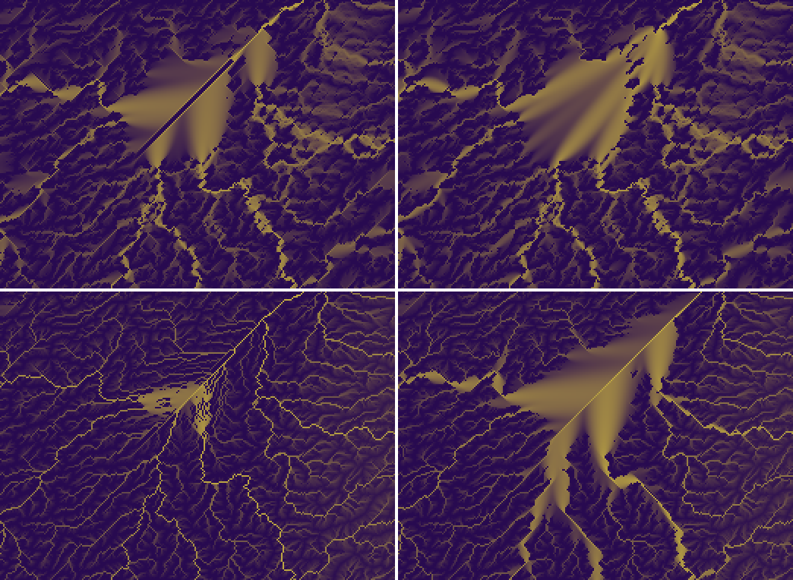

# SPIKE-108 follow-up: (b) and (c) through the production round path, and the grade of the flats

Run 2026-11-12 (architect's order, relayed by the bulldozer): re-run (b) and (c) on R1, R3a and R3b through the PRODUCTION round path, report what `regrade_flats` did per fixture, the counts per direction, and the owner's region before and after GEN-173. Numbers and images; no verdicts. Run by the spikes lane. Main 1041d28c and later (GEN-172, GEN-173 in).

Probe: `shapes_check prod` on the local branch `spike/spike-108-rerun` (never pushed). Production path: `solve_rounds` with `CarveParams { steps 20, reroute_every 5, round_rules: RoundRules::ROUND, cell_metric: true, window_cut: true }` on the window grid of `region_scale` (rectangular `Grid` with `Metric::cube_face`, margin 200, box counted). The probe's own round loop (used in the earlier reports) differs from `solve_rounds` in 0 cells on all three fixtures. The measures route the surface under `RoundRules::ROUND` (the clipped area, the canonical flood). The grade report runs `priority_flood_ungraded` and `regrade_flats` (the two halves of `priority_flood_with`) on the surface and reads the `FlatInfo` list. Raw: `raw-prod/`.

## 1. Does the grade act on the production path?

- Yes: `grid.is_cube()` is false on all three windows, the flood is canonical (`RoundRules::ROUND`), and `regrade_flats` graded flats on every fixture (nonzero below).
- What does not act: flats that touch the grid border (the window's outer ring) and flats of more than 127 cells (`FLAT_BOUND`). After the rounds the border-touching flats hold most of the flat cells of the window (R1h 90 %, R3b 74 %); the window's own border is 200 cells beyond the box, so these are flats that reach the margin.

Per fixture, on the start surface z0 and after the 4 rounds (production):

| Fixture | Surface | Flats (window) | Flats graded | Cells in graded flats / cells in all flats | Not graded: diameter over 127 (flats, cells) | Not graded: touching the border (flats, cells) | Lifted cells in the box | With a changed level (graded) |
|---|---|---|---|---|---|---|---|---|
| R1h | z0 | 7,219 | 7,099 | 245,992 / 279,614 (88.0 %) | 4, 28,864 | 116, 4,758 | 97,135 | 72,105 (74.2 %) |
| R1h | after 4 rounds | 404 | 336 | 4,774 / 63,649 (7.5 %) | 2, 1,350 | 66, 57,525 | 4,899 | 3,416 (69.7 %) |
| R3a | z0 | 10,881 | 10,779 | 211,840 / 317,092 (66.8 %) | 14, 103,584 | 88, 1,668 | 185,230 | 108,996 (58.8 %) |
| R3a | after 4 rounds | 1,618 | 1,540 | 29,177 / 83,740 (34.8 %) | 13, 29,546 | 65, 25,017 | 51,967 | 20,760 (39.9 %) |
| R3b | z0 | 16,845 | 16,703 | 350,390 / 422,571 (82.9 %) | 6, 60,161 | 136, 12,020 | 236,129 | 177,137 (75.0 %) |
| R3b | after 4 rounds | 660 | 615 | 13,288 / 65,700 (20.2 %) | 8, 3,787 | 37, 48,625 | 26,300 | 6,384 (24.3 %) |

The largest ungraded flats after the rounds (cells): R1h 10,337, 8,412, 7,189, 5,600; R3a 10,623, 4,792, 4,581, 3,622; R3b 37,634, 4,208, 3,171, 818. At z0: R1h 18,191, 4,229, 3,415; R3a 18,642, 16,475, 14,249; R3b 23,185, 14,810, 9,744.

## 2. (b) and (c) after the 4 rounds, production surface routed under ROUND

Matched DEM pool as frozen in `dem-pool-frozen.md` (high-relief for R1h, mid-relief for R3a and R3b).

| Measure | R1h | R3a | R3b |
|---|---|---|---|
| Chord 8, diagonal share within 2.5 deg (pool) | 0.0560 (0.0546) | 0.1071 (0.0394) | 0.0515 (0.0394) |
| Ratio | 1.03 | 2.72 | 1.31 |
| Chord 16, diagonal share within 2.5 deg (pool) | 0.0349 (0.0557) | 0.1037 (0.0257) | 0.0337 (0.0257) |
| Ratio | 0.63 | 4.03 | 1.31 |
| Chord 8 / 16, diagonal within 5 deg (pool) | 0.1168 / 0.1038 (0.1314 / 0.1201) | 0.2187 / 0.2311 (0.0857 / 0.0729) | 0.1215 / 0.1136 (0.0857 / 0.0729) |
| Channel length in runs > 10 cells (pool) | 0.0231 (0.0070) | 0.0699 (0.0113) | 0.0207 (0.0113) |
| Ratio | 3.30 | 6.19 | 1.83 |
| Channel length in runs > 20 cells (pool) | 0.0046 (0.0000) | 0.0390 (0.0000) | 0.0045 (0.0000) |
| Steps on lifted cells | 0.180 | 0.550 | 0.263 |

At z0 (production routing): runs > 10 R1h 0.0191, R3a 0.0513, R3b 0.0143; runs > 20 0.0062, 0.0305, 0.0025; steps on lifted cells 0.77, 0.75, 0.73.

Counts per direction after the 4 rounds (steps, share; runs over 10 cells, count; W / E / N / S / NW / NE / SW / SE; mean step vector in cells, j down):

| Fixture | Steps | Runs > 10 | Mean step vector |
|---|---|---|---|
| R1h | 0.070 / 0.150 / 0.030 / 0.264 / 0.026 / 0.087 / 0.213 / 0.160 | 5 / 6 / 0 / 3 / 1 / 2 / 6 / 2 | (+0.09, +0.49) |
| R3a | 0.157 / 0.054 / 0.151 / 0.131 / 0.213 / 0.079 / 0.132 / 0.083 | 3 / 3 / 13 / 20 / 52 / 1 / 4 / 19 | (-0.28, -0.10) |
| R3b | 0.032 / 0.258 / 0.099 / 0.116 / 0.028 / 0.221 / 0.091 / 0.155 | 0 / 25 / 11 / 11 / 1 / 24 / 2 / 14 | (+0.48, +0.01) |

- Production (C) and the earlier U figures agree within 0.0004 (diagonal shares) and 0.0002 (runs), as in `results-gen173.md`.
- R3a: one diagonal still dominates (NW 52 of 115 runs); 95 % of the NW run length lies on lifted cells (`results-gen173.md` section 5); 13 of its flats are larger than 127 cells (29,546 cells) and 65 touch the border (25,017 cells).

## 3. The owner's region before and after GEN-173


Sheet pixels x 770-1029, y 0-189 of `region-s14-f1-i8056-j760` (margin 400, window origin i 7656, j 360), doubled. Top: `round-00-area`; bottom: `h1-area`. Left: main b8c5bbb5 (before); right: main 1041d28c (after GEN-173).

What the images show: the "^" near pixel (890, 65) was two straight 45-degree lines meeting at a lifted flat (left). After the grade the round-0 flat is a fan of radial lines, and the H1 sheet has a wide flat with fans; one long straight diagonal line remains in the H1 sheet, from about pixel (970, 0) to about (850, 180) at the flat, and a second shorter one to its south-east (bottom right panel).

## 4. Caveats

- One seed per region; R1h is the 620-cell box at margin 200.
- The sheet is the H1 stage of `region_scale mem 400 8` at main 1041d28c, the "before" sheet that of b8c5bbb5.
- The pixel positions of the remaining diagonal are read off the image at 2x (about 5 pixels).

## 5. Reproduce

```
cargo build --release -p planet-generators --example shapes_check          # from spike/spike-108-rerun
PLANET_WIN=1,12288,8056,8675,760,1379,14 PLANET_MARGIN=200 shapes_check prod 8     # R3a: 4,12288,168,1187,4520,5539,15; R3b: 2,12288,9768,10787,8104,9123,15
```
