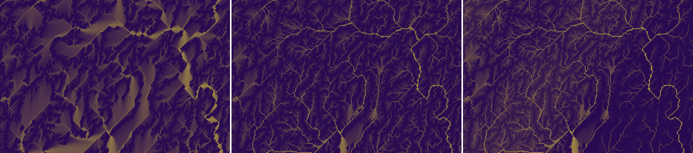
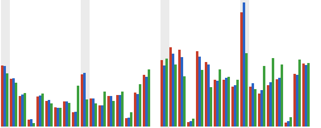
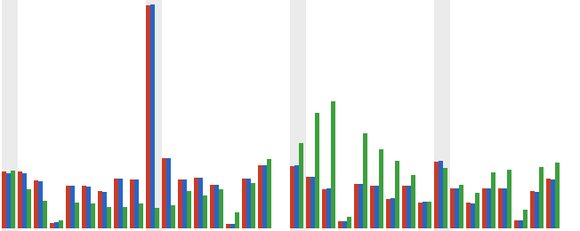
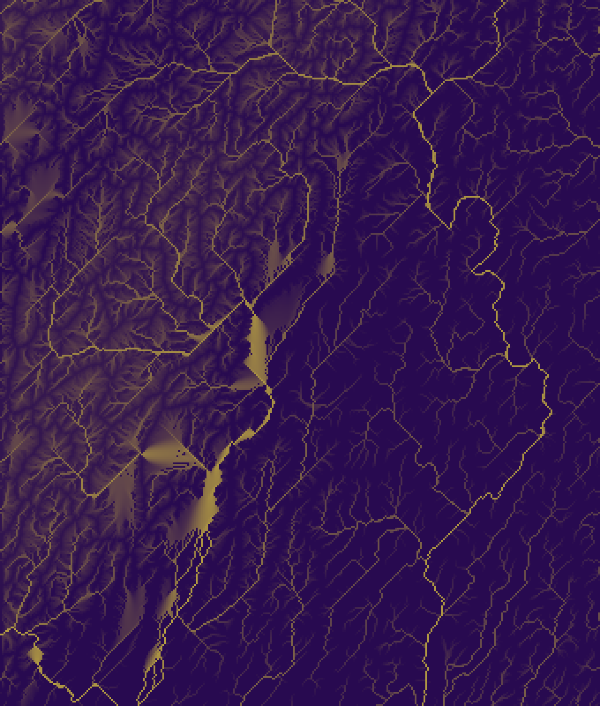
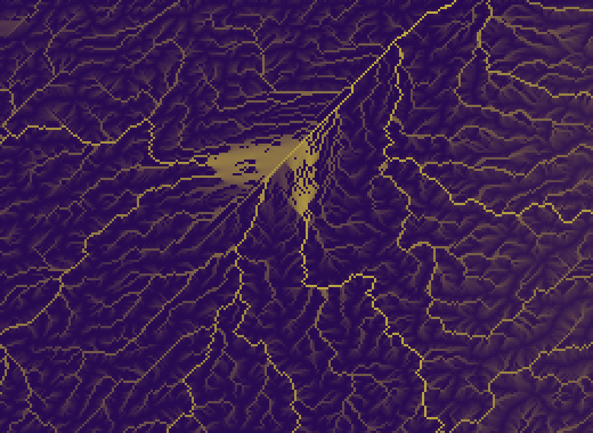
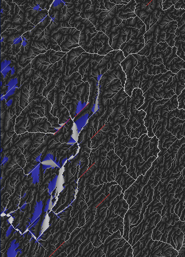

# SPIKE-108: 0/45/90-degree shapes check

Opened and run: 2026-11-11 (owner via the architect; the spikes lane). Time box 2 h, measurement only, no production change. Numbers and images; the verdict is the architect's.
Question: does the generator favour 0/45/90-degree shapes more than real terrain does, and by which mechanism?
Trigger: the owner's `h1-area.png` of `region-s14-f1-i8056-j760` (a "^" at the top centre, long straight 45-degree valleys in the left part; sheet of 2026-11-10, before GEN-162).
Bar (architect): an excess above 1.5x the DEM at 45-degree multiples, or straight runs above 2x the DEM, means a fix before the prototype's look gate; otherwise polish.

Statistics derived from Copernicus DEM GLO-30: produced using Copernicus WorldDEM-30 © DLR e.V. 2010-2014 and © Airbus Defence and Space GmbH 2014-2018 provided under COPERNICUS by the European Union and ESA; all rights reserved. The organisations in charge of the Copernicus programme by law or by delegation do not incur any liability for any use of the Copernicus WorldDEM-30. No DEM raster is in the repository.

## 1. Result in numbers

| Measure | Generator (U routing, after 4 rounds) | DEM of similar relief | Ratio |
|---|---|---|---|
| Chord 8, share within 2.5 degrees of 45/135 (diagonals) | R1 0.082 (box 0.075); R3a 0.116; R3b 0.065 | 0.058 (R1 pool); 0.039 (R3a and R3b pool) | R1 1.41 (box 1.28); R3a 3.00; R3b 1.67 |
| Chord 16, same | R1 0.055 (box 0.050); R3a 0.117; R3b 0.045 | 0.045; 0.025 | R1 1.24 (box 1.12); R3a 4.71; R3b 1.79 |
| Chord 8, share within 2.5 degrees of 0/90 | R1 0.090; R3a 0.074; R3b 0.089 | 0.086; 0.091 | 1.05; 0.82; 0.98 |
| Channel length in single-direction runs over 10 cells | R1 0.096 (box 0.073); R3a 0.113; R3b 0.051 | 0.026; 0.011 | R1 3.7 (box 2.8); R3a 10.0; R3b 4.5 |
| Channel length in runs over 20 cells | R1 0.029 (box 0.022); R3a 0.057; R3b 0.013 | 0.0095; 0.000 (0.0070 over all 15 tiles) | R1 3.0 (box 2.3); R3a 8.2 (all 15 tiles); R3b not defined |

- U and C routing give the same numbers within 0.003 on every row (section 4).
- The excess is in the diagonals and in the straight runs; the axis chords are at the DEM's level.
- Across 15 DEM tiles the run share over 10 cells is 0 to 0.078 (N40 W078): R1h-full (0.096) and R3a lie above every tile, R1h (box, 0.073) and R3b (0.051) above all but one.

## 2. Method

Probe `crates/generators/examples/shapes_check.rs` on the local branch `spike/spike-108-probe` (never merged, no production change; reads library APIs only). Release build, BelowNormal, 8 threads; CPU load 0 to 4 % before each run. The probe, the runs and this report took about 30 minutes of wall-clock time.

| Item | Definition |
|---|---|
| Channel | `A_d` at least 75 km^2 (`HydroParams::initiation_m2`), MFD area of the routing |
| Routing | `route_rules_filled`: priority flood (epsilon 1 mm, canonical), jittered D8 receivers, Freeman MFD area; U = `MfdClip::Off`, C = `RoundRules::ROUND`; the same code for the generator and the DEM |
| Chord | start at every channel cell, follow the D8 receivers through channel cells for 8 (and 16) steps; the chord vector in metres gives an axis orientation in [0, 180) degrees (1-degree bins) |
| Near a multiple | within 2.5 (and 5) degrees of 0, 45, 90, 135; uniform expectation 0.0889 (0.2222) |
| Straight run | consecutive channel steps in one D8 direction; a step counts in a run of length `u + d - 1` (steps ending at it, steps downstream from it, through the longest same-direction donor); the share is of channel length (diagonal steps weigh sqrt 2) |
| Flat | raw: no strictly lower neighbour in `z`; lifted: the fill raised the cell by at least 0.5 mm (so its level is set by the epsilon tilt) |
| Generator fixtures | 12,288 cells a face edge (814 m): R1h = face 1, seed 14, i 8056-8675, j 760-1379 (the owner's region, 620 cells, margin 200; "box"); R1h-full = the whole 1,420 x 1,420 window of the owner's sheet (margin 400, origin i 7656, j 360), so window cells equal sheet pixels; R3a, R3b = the SPIKE-107 windows (seed 15, 1,020 cells, margin 200). 4 rounds of 5 steps; counted on the box |
| DEM | the 15 GLO-30 sample tiles, block-averaged to about 814 x 803 m cells (the generator's cell size; grid and angles use the true cell dimensions), cells at or below 0 m or with half or more no-data = sea (outlet); a 10-cell rim is left out |
| DEM pools | by 3x3 steepest-neighbour slope p95: high (0.2 to 0.7; 8 tiles N27 E086, N40 W078, N42 W123, N45 E014, N47 E011, N48 E008, N57 W005, N61 E006; 3,876 channel steps) for R1 (slope p95 0.32 box, 0.44 whole window); mid (0.03 to 0.14; 4 tiles N31 W004, N41 W096, N43 W102, S25 E015; 3,398 steps) for R3a (0.069) and R3b (0.133); all 15 tiles (8,011 steps) |

## 3. (a) The flats, and the cause of the "^" fronts

Lifted cells, % of land (start surface z0 against after the 4 rounds):

| Fixture | Raw flat or pit z0 / after | Lifted >= 0.5 mm z0 / after | >= 1 m z0 / after | >= 10 m z0 / after | Lifted components z0 / after (largest, cells) |
|---|---|---|---|---|---|
| R1h (box) | 2.28 / 0.75 | 36.28 / 1.83 | 34.74 / 0.35 | 28.51 / 0.00 | 7,212 (18,191) / 345 (10,180) |
| R1h-full | 2.17 / 0.39 | 39.19 / 4.61 | 37.98 / 3.77 | 32.58 / 3.33 | 13,648 (18,191) / 637 (17,119) |
| R3a | 1.66 / 0.75 | 25.46 / 6.61 | 20.81 / 1.20 | 6.04 / 0.13 | 10,817 (18,641) / 1,393 (10,441) |
| R3b | 1.66 / 0.51 | 26.72 / 2.87 | 21.63 / 1.80 | 6.63 / 1.67 | 16,799 (23,185) / 587 (36,376) |

- 36.28 % of R1h's land is under the fill at the start: the same number as the stage probe's "region land under the fill 97119 of 267717" (`raw/region-scale-mem.txt`).
- DEM tiles, routed the same way: lifted >= 1 m is 1.0 to 17.5 % of land per tile (median 6.5 %); the uneroded generator base is 21 to 38 %, after 4 rounds 0.35 to 3.8 %.
- Where, R1h: lifted cells at z0 have z p5/p50/p95 24/624/971 m against all land 7/632/1210 m (spread over the heights, not a coastal plain); after the rounds 0/0/5 m (the coast; R1h-full 0/519/1458 m).
- The level rule holds for 100.000 % of lifted cells at every surface: level = lowest neighbour's level + epsilon, i.e. the gradient on a flat is one epsilon per 8-neighbour (chessboard) step. The receiver step of a lifted cell is a pure epsilon step for 99.8 to 100 %.
- Evidence for chessboard-distance flat routing as the cause of the 45-degree structure on flats (the architect judges):
  - the level rule above;
  - at z0, 242 of the 243 straight runs of 15 or more cells in R1h-full lie on lifted flats (R1h 37 of 38; R3a 74 of 74; R3b 76 of 76);
  - the stage sheets show the web of 45-degree diamonds at round 0 (images below).
- After the rounds the straight runs persist off the flats: of the 202 runs of 15 or more cells of R1h-full under U, 74 lie on lifted flats and 128 elsewhere (R1h 7 / 18; R3a 65 / 12; R3b 26 / 47). 97.4 % of the cells of those 128 carved runs were on lifted flats at z0 (R1h 97.7 %; R3a 81.0 %; R3b 94.6 %). The raw start surface's steepest descent agrees with the run direction (within 45 degrees) on 34 to 40 % of their cells, against 37.5 % by chance.
- Reading of the three: the filled flats of the start surface route straight along the diagonals; the carve incises valleys along those routes; the valleys remain when the fill has gone. The terrain's own noise does not point along the runs.


Left to right: `round-00-area`, `round-03-area`, `h1-area` of `region-s14-f1-i8056-j760` (sheet pixels x 0-299, y 560-759, doubled). Regenerated on main b8c5bbb5 (`region_scale mem 400 8`, 76 s), so after GEN-162; the pattern is present.

## 4. (b), (c), (d) Orientation and straight runs, in full

Share of chords within 2.5 / 5 degrees of 0/45/90/135 (axis 0/90 and diagonal 45/135 parts in brackets for 2.5 degrees). U routing after 4 rounds; C in brackets where it differs by more than 0.002.

| Set | Chord 8, 2.5 deg | Chord 8, 5 deg | Chord 16, 2.5 deg | Chord 16, 5 deg | Runs > 10 | Runs > 20 | Channel steps |
|---|---|---|---|---|---|---|---|
| R1h (box) | 0.168 (0.093 / 0.075) | 0.239 | 0.097 (0.047 / 0.050) | 0.256 | 0.0725 (C 0.0723) | 0.0216 | 16,304 |
| R1h-full | 0.172 (0.090 / 0.082) (C 0.175: 0.086 / 0.088) | 0.246 (C 0.251) | 0.101 (0.046 / 0.055) | 0.252 | 0.0964 (C 0.0996) | 0.0288 (C 0.0284) | 87,239 (C 77,949) |
| R3a | 0.190 (0.074 / 0.116) | 0.301 | 0.150 (0.033 / 0.117) | 0.318 | 0.1133 (C 0.1137) | 0.0574 | 40,687 |
| R3b | 0.154 (0.089 / 0.065) (C 0.151: 0.080 / 0.072) | 0.230 | 0.094 (0.049 / 0.045) | 0.263 | 0.0510 (C 0.0531) | 0.0131 (C 0.0144) | 60,674 (C 54,089) |
| DEM high (8 tiles) | 0.144 (0.086 / 0.058) | 0.219 | 0.087 (0.042 / 0.045) | 0.236 | 0.0263 | 0.0095 | 3,876 |
| DEM mid (4 tiles) | 0.129 (0.091 / 0.039) | 0.174 | 0.060 (0.035 / 0.025) | 0.193 | 0.0113 | 0.0000 | 3,398 |
| DEM all (15 tiles) | 0.139 (0.089 / 0.050) | 0.199 | 0.079 (0.041 / 0.038) | 0.224 | 0.0200 | 0.0070 | 8,011 |

- The start surface z0 gives the same kind of numbers (runs > 10: R1h 0.054, R1h-full 0.072, R3a 0.091, R3b 0.033; runs > 20: 0.020, 0.024, 0.049, 0.009); 67 to 78 % of z0's channel steps lie on lifted flats against 18 to 51 % after the rounds (R1h-full 0.78 and 0.34).
- (d) The clip is not mixed in: C against U differs by at most 0.006 on any chord share and by at most 0.0032 on the run shares. The raw lines of both are in `raw/`.
- Diagonal channel length is 0.59 to 0.63 of channel length in the generator against 0.52 to 0.55 in the DEM pools.
- Per DEM tile (routed U): run share over 10 cells N40 W078 0.078, N45 E014 0.044, N52 E012 0.030, N27 E086 0.028, N43 W102 0.026, N31 W004 0.018, N47 E011 0.016, S25 E015 0.0095, N42 W123 0.007, the other six 0 (96 to 1,159 channel steps each; N35 W076 has none).


Chord 8 orientation, 5-degree bins from 0 to 180 degrees, bar heights as shares of each series' chords (scaled to the tallest bar). Red: U, blue: C, green: DEM high-relief pool. Grey bands: the bins holding 0, 45, 90 and 135 degrees. `images/` also holds chord 16 and the R3a against the mid pool.



## 5. (e) The owner's two left-side 45-degree valleys

The owner's pixel positions are not at hand; the sheet was regenerated (section 3). Candidates from the probe's longest single-direction channel runs, in sheet pixels (= window cells of R1h-full; heads of the runs, global cell = pixel + (7656, 360)), left part (x below 320):

| Run (length, cells) | Head (x, y) | On the final surface |
|---|---|---|
| 34, diagonal | (125, 971) | carved: no lifted cells; run direction is the steepest descent on 34 of 34 cells; slope 0.0026 |
| 33, diagonal | (105, 762) | on lifted flats 33 of 33; slope 0.0038 |
| 30, diagonal | (286, 510) | carved; slope 0.0086 |
| 29, diagonal | (184, 817) | 19 of 29 on lifted flats; slope 0.0042 |
| 28, diagonal | (173, 700) | on lifted flats 28 of 28; slope 0.0032 |
| 27, diagonal | (275, 316), (204, 743), (187, 904) | carved (one 2 of 27 on flats) |

- Mechanism by class (section 3): the runs on lifted flats are flat routing (chessboard distance); the carved ones were flat routes at z0 and were incised by the carve along the D8 receiver chain (97 % of their cells); input noise does not account for them (raw steepest descent agrees on 34 to 40 % against 37.5 % by chance).
- The "^" at the top centre of the sheet (about pixel (890, 65)) is a lifted flat with two straight arms; the longest run of R1h-full (88 cells, head (865, 102), flowing north-east to (953, 14), global head (8521, 462)) lies on lifted flats on all 88 cells.
- To name the mechanism of the owner's two valleys exactly, the owner or the architect marks their pixel positions on the sheet (or sends the original image); the probe lists any pixel window on request (`PLANET_IMG`, `long_runs`).


Left part of `h1-area.png` (pixels 0-339 x 560-959, tripled): many 45-degree lines.


Top centre (pixels 770-1029 x 0-189, 4x): the "^": a lifted flat with straight diagonal arms.


Probe view of the left part after the rounds under U (log10 area; lifted flats blue; the longest diagonal runs red where they fall in the image).

## 6. Fix options (named, not built)

| Option | What it changes | Notes |
|---|---|---|
| Flats routed towards lower and away from higher terrain (Garbrecht and Martz) | the epsilon gradient on a flat: one field from the pour points, one away from the higher rim, combined; or a Euclidean distance from the pour points | acts at the cause (the flats of the start surface and of the fills); must keep the canonical visit order (CON-28 to CON-30, same bits on any partition) |
| A deterministic jitter on ties | adds `eps * jitter(id)` to the flat's levels | breaks the straight fronts at cell scale; D8 receivers still step diagonally; weaker |
| Carving along MFD or D-infinity instead of the D8 receiver | the implicit carve's receiver | acts on the persistent valleys (the 128 carved runs); a change of the carve kernel and of GEN-141's clip rules; larger |
| Breach instead of fill at round 0 | fewer lifted cells at the start (21 to 38 % of land) | removes the flats instead of routing them; changes erosion volumes |

## 7. Caveats

- Samples: one region and seed for R1 and one second seed for R3a and R3b; 15 DEM tiles of 1 x 1 degree (about 100 x 138 cells each); the pools hold 3,398 to 8,011 channel steps, chords overlap (the effective sample is smaller). The channel counts of single DEM tiles are 96 to 1,159.
- DEM channels come from the same routing on a block-averaged DSM at 814 m; the real rivers of a DEM include its own drainage shapes. Similar relief is by slope p95 only (a coarse match: R3a at 0.069 sits between the pools).
- The generator is measured on the surface after 4 rounds, before the sediment pass and the H1 pass; the sheet is the H1 stage. The z0 and the rounds' values show the same runs.
- Angles of the generator use grid coordinates times `dx` (the cube-face metric of up to a few per cent is ignored).
- The stage sheet is the sheet of main b8c5bbb5, not the owner's of 2026-11-10.

## 8. Reproduce

```
cargo build --release -p planet-generators --example shapes_check          # from spike/spike-108-probe
PLANET_WIN=1,12288,7656,9075,360,1779,14 PLANET_MARGIN=0 PLANET_IMG=0,360,500,1000 shapes_check gen 8     # R1h-full
PLANET_WIN=1,12288,8056,8675,760,1379,14 shapes_check gen 8                                               # R1h (margin 200)
PLANET_WIN=4,12288,168,1187,4520,5539,15 shapes_check gen 8 ; PLANET_WIN=2,12288,9768,10787,8104,9123,15 shapes_check gen 8
shapes_check dem                                  # all tiles; PLANET_SLOPE=0.2,0.7 (high) or 0.03,0.14 (mid) selects a pool
shapes_check hist out.png 0 "file#U rounds, routed U" "file#pooled U"   # orientation chart from the RAW lines
region_scale mem 400 8                            # the stage sheets of the owner's region
```

Raw output: `raw/` (the `RAW` lines hold the 1-degree chord histograms).

## 9. Visuals

| Image | Shows |
|---|---|
| `images/R1-stages-round0-round3-h1.png` | the left part of the owner's region at round 0, round 3 and H1 (area): the diamonds of the start surface and the straight lines that remain |
| `images/R1-h1-area-left-crop.png` | the left part of `h1-area.png`, tripled |
| `images/R1-h1-area-top-centre-crop.png` | the "^" at the top centre, 4x |
| `images/R1-left-area-runs-rounds-U.png` | the probe's area map of the left part after the rounds (lifted flats blue) |
| `images/orient-*.png` | chord orientation charts: R1h-full against the high-relief DEM pool and R3a against the mid pool, chords of 8 and 16 |

## 10. Addendum (architect, 2026-11-11): the breach chains, and three direction-jitter forms

### 10.1 Where the owner's two valleys are

Per the architect's reading, the two 45-degree valleys are U's breach trenches in `spikes/mfd-comparison/results/images/R3b-hillshade.png`, panel U, top left: they start at the window's top edge (the cut root) and cross the flat left by the depression fill. Section 5's candidate list is for the owner's sheet of the other region. The probe reproduces the trench class (10.3).

### 10.2 Method

`shapes_check breach` (probe branch `spike/spike-108-probe`): the breach of a round, as in `catchment_round` (`z[rec] = max(z[c] - 0.001 dist, floor, exit base under C, z[rec] - 500 m)` for a receiver higher than its donor allows), applied region-wide on the surface at the start of the round (the library's solved surface after the earlier rounds of the same rules; round 1 = the start surface), visiting the cells in the reversed receivers-first order.

| Item | Definition |
|---|---|
| Lowered cell | a receiver the breach lowered; its lowering is the sum of its passes |
| Chain | lowered cells linked along their D8 receivers; a step is a lowered cell whose receiver is also lowered |
| Exit class | the root outlet of the cell's catchment: `cut` = a land cell (a window cut), `sea` = at or below the sea level (the water reaches the sea: interior spills and rims of basins that drain to the sea) |
| Straight share | the share of chain length (diagonal steps weigh sqrt 2) in single-direction runs over 10 (and 20) cells |
| Angle of a run | axis (0/90 degrees), diagonal NW-SE, diagonal NE-SW; counted once per run |
| Edge end | a run over 10 cells whose downstream end lies within 10 cells of the window border |

Fixtures: R3b at margin 0 (the SPIKE-107 window, the trenches' window) and at margin 200 (box = the inner 1,020 cells); R3a and R1h at margin 200; R1h-full (margin 0, whole 1,420 window). 4 rounds, U and C. Raw: `raw/breach-*.txt`.
Caveats: the breach is emulated region-wide in the receivers-first order, not per catchment's index order; classes by root outlet, so a basin that drains to a window cut counts as `cut`; one seed per region.

### 10.3 Window-cut chains: the trenches (R3b, margin 0, the SPIKE-107 window)

| Round | Rules | Exit | Lowered cells (mean / max m) | Straight share > 10 / > 20 | Longest run | Runs > 10 (axis / NW-SE / NE-SW), edge ends | Lowering in runs > 10 (mean / max m) |
|---|---|---|---|---|---|---|---|
| 1 | U | cut | 87,583 (12.7 / 346) | 0.028 / 0.006 | 103 | 135 (42 / 22 / 71), 3 | 53.0 / 340 |
| 2 | U | cut | 12,785 (5.6 / 299) | 0.041 / 0.023 | 97 | 18 (2 / 7 / 9), 5 | 54.6 / 287 |
| 3 | U | cut | 6,363 (13.4 / 332) | 0.078 / 0.039 | 94 | 19 (1 / 6 / 12), see raw | see raw |
| 4 | U | cut | 5,534 (19.2 / 361) | 0.099 / 0.048 | 98 | 22 (3 / 6 / 13), 10 | 46.6 / 311 |
| 4 | C | cut | 10,104 (2.7 / 16) | 0.048 / 0.013 | 53 | 27 (6 / 8 / 13), 0 | 4.2 / 8 |

- Under U, 10 of the 22 runs over 10 cells of round 4 end within 10 cells of the window border, and the lowering in the runs is 47 m on average and 311 m at most: the trenches. Under C (the exit base holds the breach at the exit's level) none ends at the border and the lowering is 8 m at most.
- With margin 200 the same class exists behind the margin's cut (R3b round 4 under U: lowering in the runs mean 61 m, max 297 m; 13 runs; under C mean 4.8 m, max 9 m) and none ends at the box border: the inner box excludes them, as the architect noted.

### 10.4 Interior chains (sea-exit class), U, rounds 1 and 4

| Fixture | Round | Lowered cells (mean / max m) | Straight share > 10 / > 20 | Longest | Runs > 10 (axis / NW-SE / NE-SW) | Lowering in runs (mean / max m) |
|---|---|---|---|---|---|---|
| R3b m200 | 1 | 156,458 (14.8 / 433) | 0.027 / 0.006 | 63 | 244 (79 / 38 / 127) | 48.4 / 386 |
| R3b m200 | 4 | 17,953 (1.7 / 25) | 0.033 / 0.012 | 37 | 31 (4 / 11 / 16) | 4.2 / 24 |
| R3a m200 | 1 | 148,098 (5.4 / 261) | 0.047 / 0.019 | 179 | 332 (186 / 118 / 28) | 18.2 / 245 |
| R3a m200 | 4 | 54,714 (0.4 / 10) | 0.079 / 0.043 | 179 | 158 (49 / 95 / 14) | 1.2 / 6 |
| R1h m200 | 1 | 54,622 (65.1 / 811) | 0.034 / 0.013 | 64 | 91 (33 / 21 / 37) | 189.0 / 717 |
| R1h m200 | 4 | 8,174 (1.6 / 38) | 0.059 / 0.024 | 62 | 22 (8 / 6 / 8) | 4.6 / 12 |
| R1h-full | 1 | 171,589 (77.5 / 1,171) | 0.040 / 0.011 | 64 | 355 (87 / 67 / 201) | see raw |
| R1h-full | 4 | 23,493 (1.3 / 114) | 0.050 / 0.019 | 61 | 54 (9 / 15 / 30) | see raw |

- The straight share of interior breach chains is 0.027 to 0.047 in round 1 and 0.033 to 0.079 in round 4, the same range as the whole channel network (0.05 to 0.11, section 4); the window-cut class under U is higher in the later rounds (0.07 to 0.14 in rounds 2 to 4 of R1h-full and R3b) and deep.
- Round 1 digs deep inside straight runs at interior spills too (mean 48 to 189 m in the runs of R3b and R1h, 717 m at most): the start surface's flats are breached along their routes at the first round. From round 2 the interior lowering is a few metres (mean 1.2 to 4.6 m).
- R3a's interior runs are mostly NW-SE (95 of 158 in round 4) and R3b's mostly NE-SW (16 of 31): one diagonal dominates per fixture.
- C against U on interior chains: the same within 0.003 (R3b 0.034 / 0.033, R3a 0.080 / 0.079, R1h 0.062 / 0.059). C changes the cut class only (10.3).

### 10.5 Three direction-jitter forms (named and estimated; nothing built)

Today's rule (`route.rs`): the receiver is the neighbour of the largest slope times `1 + 0.5 u`, `u` a hash of (global cell id, direction) in [-1, 1) (CON-14, CON-29). The flats' gradient is one epsilon per 8-neighbour step (section 3), set by the flood, not by the receiver choice.

| Form | What it changes | Acts on | Likely effect on this check's measures (estimate, not measured) | Cost |
|---|---|---|---|---|
| (i) Node-position jitter | each cell centre gets a hashed offset (say within 0.25 cell), so neighbour distances and slopes differ and are symmetric between the two cells of a pair | slope-driven choices (receivers, MFD weights, carve distances); the flats' levels only if their gradient is made distance-based | spreads chord angles by a few degrees on slopes, so the diagonal and axis peaks shrink somewhat; the flats' fronts stay (the level rule does not read distances); expected reduction of the straight-run excess: small to moderate | the largest: every kernel that reads a distance (route, MFD, carve, hydrology, K7, the metric tables) must use the offset distances; a distance table per cell |
| (ii) Stochastic D8 (rho8) | the receiver is drawn among the lower neighbours with probability proportional to slope times a hashed weight (today's rule is a bounded form of it) | the receiver of every cell | on a flat a cell has 1 to 3 lower neighbours, so a path is a random walk: a run of n steps in one direction has probability of about 0.5^n to 0.3^n, and runs over 10 cells on flats nearly vanish; on slopes the steepest neighbour keeps the largest weight and straight runs shorten less; the carve follows the receivers, so the carved valleys of the 128 off-flat runs wiggle at cell scale; expected: the run share over 10 cells moves from 0.05 to 0.11 towards the DEM's 0.01 to 0.03, with more sinuous channels | low: the receiver choice only (the tree stays a tree: receivers are strictly lower); drainage areas (MFD) are unchanged; every receiver and carve result changes (goldens) |
| (iii) Tie jitter on flats | a hashed offset of a few epsilon added to the level of each flat cell (an offset below one epsilon cannot reorder the chessboard rings) | the flood's flat levels only | removes the chessboard rings and the 45-degree medial lines on flats, the cause found for 242 of 243 runs at the start surface and, through the breach and the carve, for about 97 % of the cells of the carved runs; slopes unchanged; expected: runs on flats nearly vanish and the overall run share over 10 cells drops by roughly half or more (R1h 0.07 towards 0.03 to 0.04); the flats stay flat to within a few millimetres | low: the flood only (the visit key stays (level, id), so the order stays total); every filled surface changes bit for bit |

- Order by likely effect on the measured cause per cost: (iii), then (ii), then (i). (iii) and (ii) can be combined with the flats' gradient of section 6 (Garbrecht and Martz), which removes the rings instead of roughening them.
- All three use a hash of the global cell id and no RNG stream (CON-14, CON-29), so a partition changes nothing.
