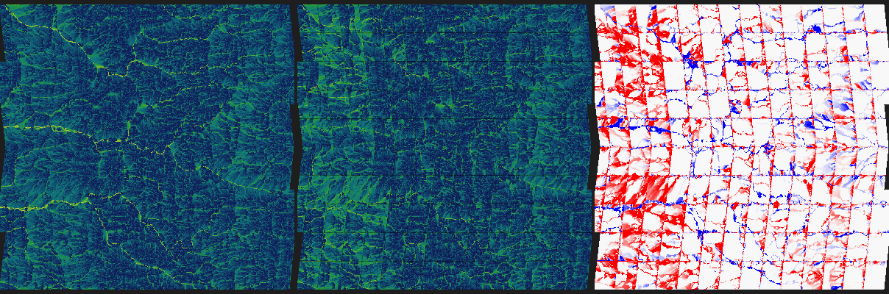
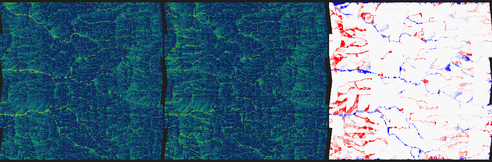
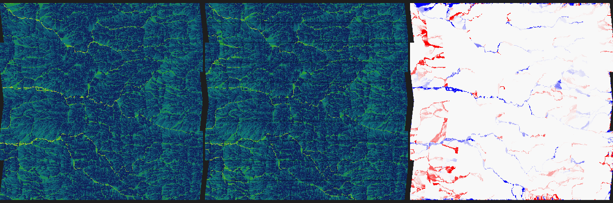
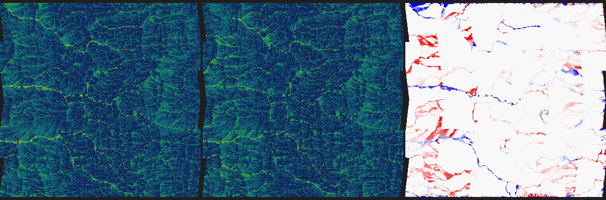
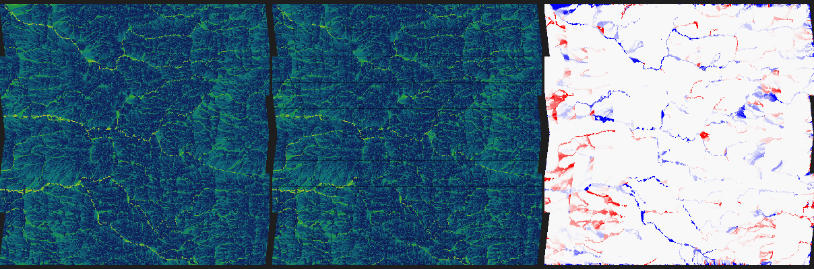
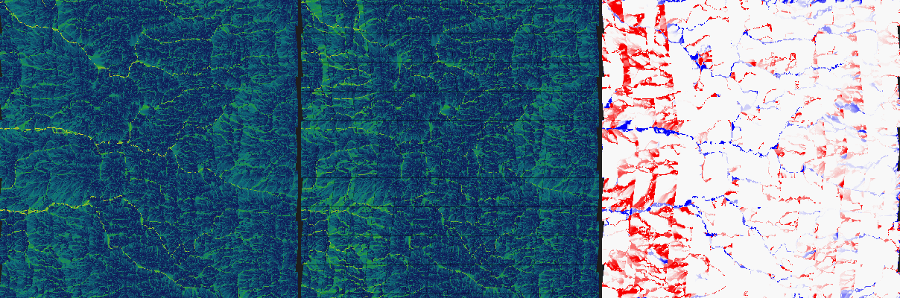
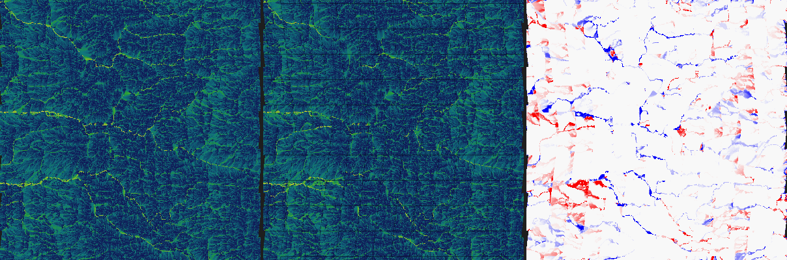

Opened: 2026-10-22
Question: Does a coarse global hydrology bake plus regional refinement on demand (SPIKE-30's recommendation) reach the quality of a fine simulation of the whole region, or does the coarse base cap the final quality; and what does it cost against a full fine bake?
Why it matters: ADR 0076 (proposed) and M8 commit to a driver-map storage and bake scheme; the owner worries that a coarse base limits the result.
Time box: about 4 h of agent work, indicative on the dev machine (other sessions were building at the same time), no perf window, no `cargo xtask perf`.
Success criteria: a ground truth at about 100 m over a mountain region that crosses a cube edge; the two-scale scheme measured against it on river courses, border continuity, wetness error and partition invariance; the 1.5 x across-edge ratio of SPIKE-30 investigated; the cost of a full fine bake extrapolated.
Fallback if it fails: regional refinement only from the player's own tile neighbourhood with no coarse inflow (rivers end at patch edges), or a full fine bake streamed to disk.
Code location: `spikes/two-scale-hydrology/proto/` (throwaway; kept as `two-scale-prototype.patch` in this folder, not merged).

# SPIKE-31: two-scale hydrology

## Verdict
- **Two-scale reaches the truth's quality for the drainage network and for the wetness and soil drivers, within a floor that the coarse base sets, when each patch carries a halo of about 5 to 10 km of its own fine terrain (1 to 2 coarse rings at 2048).** With 25 km patches and a 10 km halo (2 rings at 2048): the mean change in ln(upstream area) is 0.06 to 0.08 (a 6 to 8 % change in upstream area, median 0.000), river cells of 25 km2 and more are found within 2 cells (200 m) with recall 0.93 to 0.95 and precision 0.93 to 0.97, the top 1 % flow cells with recall 0.90 to 0.92, soil depth error 0.003 to 0.005 m on average. With a 5 km halo (25 km patches) the mean is 0.09 to 0.12 and the river cells 0.91 recall, 0.86 to 0.96 precision. Without a halo (the patch border is an outlet with coarse inflow only) it is not good enough: mean 0.2 to 0.7, river recall 0.7 to 0.9, precision 0.45 to 0.86, and a top river cell at a border loses more than half its area to its lower neighbour at 80 to 88 % of the crossings.
- **The floor is the coarse inflow itself.** A 200 km region solved at once at 100 m with inflow from the coarse bake at its border differs from the 100 km truth (the same coarse inflow, a nearer border) by a mean 0.035 to 0.046 in ln A, with the top 0.1 % flow cells (the largest rivers) matching within 2 cells only at 0.90 to 0.95. So the coarse base caps how well the **position and amount of the largest rivers** are known near any border (about 5 %), and the small and medium network is not capped (it is recomputed from fine heights; the region's own errors are zero at the median).
- **The coarse resolution does not matter, the halo in km does.** At the same halo distance a 2048 and a 4096 coarse grid give similar errors (halo 4.9 km, 10 km patches: 0.166 at 2048 and 0.177 at 4096 from base heights, 0.121 and 0.098 from eroded heights). 2048 (3.7 s, 0.7 to 1.1 GB) is enough; 4096 costs 4 to 10 x more to bake (up to 61 s measured under load, 1.7 to 1.9 GB) for no clear gain.
- **A coarse bake that sees the eroded heights is better by 20 to 30 %** (mean 0.121 against 0.166 for 10 km patches with a 5 km halo; BIG-TRUTH floor 0.039 against 0.046): the coarse base routes by the same terrain the fine solve sees. Open design question for the architect: it makes the global hydrology stage read the local erosion field (CON-08 ordering; the erosion field reads the global bake, so the graph stays acyclic).
- **Seams are not gone.** Border steps in ln A match the truth (0.89 to 0.95 against 0.90 inside patches and in the truth with a halo, 2.4 to 2.9 without), but a top-1 % river cell at a patch border still loses more than half its area to its lower neighbour in the next patch at 33 to 61 % of the crossings with a halo (truth: 14 to 27 %, a split by multiple flow direction), even with a 10 km halo. A visible step in the river's size remains at some borders. Mitigation (not built): blend overlapping patches by the distance to their own borders (the error falls from 0.14 within 5 cells of an own border to 0.05 beyond 60 cells; the halo overlap holds the better value).
- **Partition invariance is approximate, not exact:** two tilings (a 10 km tiling and the same shifted by half a patch, or 10 km against 25 km) differ with a 10 km halo by a mean 0.03 to 0.07 in ln A, p90 0.005 to 0.12, p99 0.8 to 1.6 (a factor 2 to 5) and a maximum of 5 to 11 (a few river cells that move); with a 5 km halo the mean is 0.07 to 0.15 and p90 0.08 to 0.43. CON-08's metamorphic test can hold exactly only if the patch grid is part of the field's definition (the block is the unit of computation and of the cache key, so every consumer partition reads the same blocks); a re-tiling is then a new field version within the bounds above.
- **Cost:** a patch is cheap on demand: 10 km patch with a 2.4 km halo at 4096 coarse is 20.7 k fine cells, about 31 ms of CPU; with a 5 km halo (at 2048) 37 k cells and 55 ms; there is no whole-planet storage but the coarse grid (25 MB per channel at 2048). A full fine bake costs 40 min of CPU at 600 m and about 23 h at 100 m (sections below), and 1.6 GB and 116 GB of disk. Two-scale wins by never computing what nobody looks at; for the whole planet at 100 m it would cost 1.2 to 2 x the CPU of the exact streamed bake (one pass at a halo overhead of 2.3 to 4 x against two passes).
- **The cube-edge 1.5 x of SPIKE-30 is a grid property, not a seam bug** (below): the neighbour relation across an edge is exact (0 one-sided pairs); the model distance (the square root of the cell areas) is 10 % too short across an edge, which explains a quarter (MFD) to a half (D8) of the excess; the rest equals what pairs touching the outermost row inside a face show (1.25 x), so it follows the anisotropy of the cells near a face edge, not the crossing.

## Method
- Prototype (`two-scale-prototype.patch`, a standalone crate over `planet-generators`, building on the SPIKE-30 prototype): Windows, release build, one process at below-normal priority, 4 threads for the height sampling, routing sequential. **Timings are noisy: another session was building** (the same 1.3 M-cell solve took 0.8 to 1.2 s; the coarse flood at 4096 took 19 to 61 s). The numbers that carry the findings are error measures and cell counts, which do not depend on the load.
- **World:** seed-42 single planet at Earth's radius; the region is the best-relief point on a cube edge (relief 898 m in 45 km, land above 300 m; lat -44.64, lon -99.02, faces 3 and 5, i.e. -y and -z), a 100 km square (gnomonic, axes along and across the edge). "Mountainous" is modest: this world's global field has ranges but no alpine relief at this latitude. The fine grid: 98304 cells per face edge (102 m), made of whole coarse cells (24 per edge at 4096, 48 at 2048), so a fine cell has exactly one coarse parent and a patch is a set of whole coarse cells. The fine heights are the world's eroded field (`ErosionField` over a 2048 in-memory bake, ADR 0030 point 1), the same function for truth and patches. The region is 1.30 M cells (2048) or 1.38 M cells (4096; the union of coarse cells whose centres lie in the square).
- **Coarse bake:** the SPIKE-30 pipeline (priority-flood with epsilon from the coast, multiple flow direction, slope^1.1), at 2048 (5 km) and 4096 (2.4 km), from two height sources: the global field (base) and the eroded field.
- **Ground truth:** the whole region solved at once, fine priority-flood with the region border as outlets, MFD routing, soil depth; the inflow from outside is the injection below.
- **Injection (the unsolved part of SPIKE-30):** the coarse flux of the edge between an outside coarse cell D and an inside cell C is `A_coarse(D) x w(D -> C)`, the MFD weight D gives C on the coarse filled surface (a diagonal neighbour gives a corner cell). It is added to the upstream area of the fine cells of C along that side, spread with weights `(zmax - z + 1 m)^p` over the side's cells (`p = 2`: concentrated in the valley bottom, `p = 0`: uniform, `p = 4`: concentrated more). Everything inside the region is routed by the fine heights. All coarse neighbour pairs across a face edge are symmetric (0 pairs lost).
- **Two-scale:** the region cut into patches of whole coarse cells (10 km: 4 cells at 4096, 2 at 2048; 25 km: 10 and 5), each solved independently over its core plus a halo of 0, 1 or 2 coarse rings (the halo's cells are solved and thrown away), with the injection at the border of core plus halo; a second 10 km tiling shifted by half a patch for the partition test.
- **Metrics:** over the land cells of the region (all of it): mean, median, 90th and 99th percentile of |ln A mosaic - ln A truth| (the wetness index ln(a / tan slope) differs only by this term since the slope is identical), by distance to the patch's own border; recall and precision of the top 1 % and 0.1 % flow cells and of the cells with A >= 25 km2, exactly and within 2 cells (about 200 m); soil depth error; the step in ln A of orthogonal neighbours across patch borders against inside patches; the number of top-1 % river cells at a border whose lower neighbour (by the fine heights) in the next patch has less than half the area ("broken") against the truth at the same pairs.

## Results: the two-scale scheme against the truth
Coarse grid 2048, coarse bake from the **eroded** heights (the better variant; the base-height variant is in the second table). 10 and 25 km patches, halo in coarse rings (1 ring = 4.9 km). "Cells solved" is the work, relative to the region (the halo is solved and discarded).

| Tiling | Cells solved | Mean abs d(ln A) | p99 | Top 1 % recall / precision (2 cells) | Top 0.1 % | Rivers A >= 25 km2 recall / precision | Border step (truth) | Broken river cells (truth) | Soil error m |
|---|---|---|---|---|---|---|---|---|---|
| 10 km, no halo | 1.0 x | 0.458 | 4.98 | 0.61 / 0.59 | 0.43 / 0.49 | 0.71 / 0.64 | 2.40 (0.89) | 612 of 699 (54) | 0.0146 |
| 10 km, halo 1 (4.9 km) | 4.1 x | 0.121 | 2.18 | 0.75 / 0.78 | 0.62 / 0.74 | 0.86 / 0.90 | 0.92 (0.89) | 79 of 179 (38) | 0.0062 |
| 10 km, halo 2 (9.8 km) | 9.2 x | 0.076 | 1.68 | 0.87 / 0.89 | 0.61 / 0.65 | 0.93 / 0.96 | 0.89 (0.89) | 65 of 154 (42) | 0.0040 |
| 25 km, no halo | 1.0 x | 0.226 | 3.74 | 0.80 / 0.79 | 0.71 / 0.78 | 0.87 / 0.81 | 2.45 (0.90) | 203 of 236 (16) | 0.0079 |
| 25 km, halo 1 (4.9 km) | 2.1 x | 0.086 | 1.82 | 0.85 / 0.88 | 0.49 / 0.56 | 0.91 / 0.96 | 0.95 (0.90) | 29 of 55 (9) | 0.0045 |
| 25 km, halo 2 (9.8 km) | 3.7 x | **0.063** | 1.62 | **0.92 / 0.91** | 0.66 / 0.73 | **0.95 / 0.97** | 0.91 (0.90) | 21 of 64 (9) | 0.0033 |
| 10 km, halo 1, uniform injection (p = 0) | 4.1 x | 0.129 | 2.24 | 0.76 / 0.77 | 0.61 / 0.72 | 0.88 / 0.88 | 0.93 (0.89) | 73 of 170 (34) | 0.0065 |
| 10 km, halo 1, injection p = 4 | 4.1 x | 0.120 | 2.18 | 0.75 / 0.78 | 0.62 / 0.74 | 0.86 / 0.90 | 0.92 (0.89) | 83 of 184 (40) | 0.0061 |
| **200 km solve cut to the 100 km (the floor)** | 4.2 x | **0.039** | 1.13 | 0.98 / 0.98 | 0.95 / 0.91 | 0.97 / 0.98 | none | none | 0.0013 |

Coarse grid 2048, coarse bake from the **global (base) heights**:

| Tiling | Cells solved | Mean abs d(ln A) | p99 | Top 1 % recall / precision | Rivers A >= 25 km2 recall / precision | Broken river cells (truth) |
|---|---|---|---|---|---|---|
| 10 km, no halo | 1.0 x | 0.556 | 5.16 | 0.55 / 0.40 | 0.75 / 0.50 | 697 of 852 (58) |
| 10 km, halo 1 | 4.1 x | 0.166 | 2.58 | 0.75 / 0.62 | 0.89 / 0.79 | 73 of 139 (36) |
| 10 km, halo 2 | 9.2 x | 0.103 | 2.00 | 0.89 / 0.78 | 0.93 / 0.89 | 74 of 151 (47) |
| 25 km, halo 1 | 2.1 x | 0.117 | 2.12 | 0.85 / 0.77 | 0.91 / 0.86 | 31 of 51 (9) |
| 25 km, halo 2 | 3.7 x | 0.083 | 1.81 | 0.90 / 0.83 | 0.94 / 0.93 | 27 of 61 (11) |
| 200 km solve (floor) | 4.2 x | 0.046 | 1.41 | 0.97 / 0.96 | 0.95 / 0.97 | none |

Coarse grid 4096 (halo in coarse rings of 2.4 km; same region, same metrics; the full table is in `raw/twoscale-4096.txt`), from the eroded heights: 10 km halo 1 (2.4 km): mean 0.145, rivers 0.83 / 0.86; halo 2 (4.9 km): 0.098, 0.88 / 0.92; 25 km halo 2: 0.075, 0.93 / 0.96; floor 0.035. From the base heights: 0.258, 0.177, 0.123, floor 0.045. The same halo distance in km gives the same error at both coarse resolutions.

- **Error by distance from the patch's own border** (2048, eroded coarse, mean |d ln A|; cells at under 5, 5 to 20, 20 to 60, 60 and more from the border): 10 km no halo 1.05 / 0.39 / 0.21; halo 1 0.19 / 0.11 / 0.10; halo 2 0.13 / 0.07 / 0.06; 25 km halo 2 0.14 / 0.06 / 0.06 / 0.05. The median is 0.000 in every bucket with a halo: the error is a few rivers that moved.
- **Main river courses (top 0.1 % flow cells, the large rivers):** recall within 2 cells only 0.43 to 0.71 for every tiling (floor 0.90 to 0.95): which cell a big river passes through is decided by the coarse inflow and the valley's cross-profile at the border, and it varies with the tiling. The 1 % and the A >= 25 km2 sets (the medium and small network) are what two-scale gets right.
- **Injection weights hardly matter once there is a halo:** uniform, p = 2 and p = 4 give mean 0.129 / 0.121 / 0.120 (eroded coarse, 10 km halo 1; 0.178 / 0.166 / 0.162 for the base coarse). Without a halo the weights matter more (0.65 against 0.56 at base coarse). The halo lets the fine terrain re-concentrate the flux; the choice of weights does not need to be clever.
- **Mass:** the flux injected through the 288 coarse edges of the region (2048) is 4418 km2 (base) or 3175 km2 (eroded coarse); the largest upstream area in the truth is 3095 and 3117 km2. No coarse pair across a face edge was one-sided (0 lost).

### Partition invariance (CON-08)
Mean, p90, p99 of |ln A tiling A - ln A tiling B| over the region, 2048 coarse, eroded (base coarse in parentheses where it differs a lot):

| Tilings compared | Mean | p90 | p99 | Max |
|---|---|---|---|---|
| 10 km against the same shifted by half a patch, no halo | 0.578 (0.679) | 1.89 | 4.99 | 11.3 |
| same, halo 1 (4.9 km) | 0.102 (0.146) | 0.25 | 1.84 | 10.4 |
| same, halo 2 (9.8 km) | 0.050 (0.070) | 0.058 | 1.21 | 5.4 |
| 10 km against 25 km, halo 1 | 0.071 (0.105) | 0.080 | 1.60 | 10.4 |
| 10 km against 25 km, halo 2 | **0.029** (0.043) | 0.005 | 0.77 | 5.9 |

At 4096 (rings of 2.4 km) a halo of 2 rings (4.9 km) gives mean 0.086 (shifted tiling) and 0.058 (10 km against 25 km), p99 1.6 and 1.4 from eroded heights; a 9.8 km halo (4 rings) was not run. A stated bound with a 10 km halo (2 rings at 2048): 90 % of the cells within 0.06 to 0.12 (6 to 12 %) in upstream area between two tilings, 99 % within ln 1.2 to 1.6 (a factor 3.3 to 5), the worst cells (a few moved river cells) with ln 5 to 6. **It is not bit-exact and cannot be**: the field depends on where its borders are. The metamorphic test of CON-08 can hold it exactly only by fixing the patch grid as part of the field's definition (a fixed block grid on the coarse cells, the block a cache key; blocks computed independently, consumers of any partition read the same blocks); a change of the block size or origin is a new version.

## The cube-edge ratio of SPIKE-30 (1.5 x)
Measured on the 1024 grid (`raw/edgediag-1024.txt`):

| | Inside a face | Across a face edge |
|---|---|---|
| Orthogonal pairs listing each other | all | all: 0 of 24,576 one-sided (the neighbour always lists the cell back, 50 % at a different index because the axes rotate across the edge) |
| Centre distance, exact (land pairs) | 9084 m | 9250 m (x 1.018) |
| Model distance (square root of the areas) | 8992 m | 8371 m (x 0.931); exact over model 1.010 inside, **1.105 across** |
| Mean abs height step | 6.44 m | 6.08 m (x 0.944) |
| Mean abs d(ln A), MFD, model distances | 0.114 | 0.171 (**x 1.50**) |
| MFD, exact distances | 0.114 | 0.157 (x 1.38) |
| MFD, same-face pairs touching the outermost row | 0.137 | across is x 1.25 these |
| D8, model / exact distances | 0.459 / 0.453 | 0.710 / 0.574 (x 1.55 / 1.27) |

- The crossing itself is sound: the neighbour relation is symmetric, and the heights are continuous (the height steps across are smaller, x 0.94).
- Part of the excess is the distance model: the square root of the cell areas is 10 % too short across an edge (exact over model 1.105), so the slopes and the weights are biased; with exact distances MFD drops from 1.50 to 1.38 (a quarter of the excess) and D8 from 1.55 to 1.27 (a half).
- The rest (about x 1.25) equals what same-face pairs on the outermost row show against the rest of the face (0.137 against 0.114): it is a property of the cells near a face edge, whose shape is anisotropic under the tangent warp (cells are not squares there), not of the crossing. Not isolated further (the aspect of the cells at the edge was not measured). **Consequence:** the fine grid's own edge behaviour is mild enough that the truth and the patches cross the edge without a visible step (the region crosses it in the middle of the images); an exact per-direction distance in the slope weights is cheap to add (a few percent) and removes a quarter to a half of the effect.

## Cost against a full fine bake
Per-cell costs measured in SPIKE-30 and here: height from the world's field 1.3 us per cell per thread (global or eroded, the same), routing and derivation 0.2 us per cell sequential, a 1.38 M-cell region 0.9 s on 4 threads; 16.4 B per cell of working set; a disk write of 79 MB/s measured with fsync (a 2 GiB file, other sessions active, so low; a sequential NVMe is several times faster).

| | At 600 m (16384 per face edge) | At 100 m (98304 per face edge) |
|---|---|---|
| Cells (6 faces) | 1.61 G (land 0.76 G) | 5.8 x 10^10 (land 2.75 x 10^10) |
| One exact pass (sample and route), CPU | 1.5 us x 0.76 G = **19 min** | 1.5 us x 2.75 x 10^10 = **11.5 h** |
| Exact streamed bake (blocks of 1024 x 1024 with a one-pass-per-block spill graph, solved twice) | about 40 min CPU, **2.5 min on 16 ideal threads** | about **23 h CPU, 1.5 h on 16 ideal threads** |
| Disk, 2 x 8-bit channels (flow, soil), land only | 1.5 GB (3.2 GB for the whole grid) | 55 GB (116 GB for the whole grid); 12 min at 79 MB/s (116 GB: 24 min) |
| Block-border graph (4 x 1024 cells per block, about 12 B) | 1,536 blocks: 75 MB | 55,000 blocks: 2.7 GB |
| Working set | one block with halo: 17 MB per thread | the same |
| Two-scale on demand, one 10 km patch (core 9216 cells at 100 m) | 31 ms (halo 2.4 km at 4096) or 55 ms (halo 4.9 km at 2048) | the same; nothing stored but the coarse grid (25 MB per channel at 2048) |
| Two-scale over the whole planet (halo overhead 2.3 to 4 x, one pass) | 1.2 to 2 x the exact bake's CPU | the same factor |

- The exact streamed bake (the "full fine bake out of core") is **itself a two-scale scheme**: the block summary (border heights and spill levels) is its coarse level, and the second pass injects exactly what the first pass produced; so its cost is two passes plus the border graph. It is exact (no floor, no halo, bit-exact for a fixed block order) but needs the whole planet before the first tile is exact and 55 to 116 GB of disk at 100 m.
- At 600 m the exact bake fits the existing bake budget (10 min on the reference machine, GEN-014) on 16 threads; it was not run here (no streamed implementation, estimate only). At 100 m it is a day of CPU: not a startup bake.
- **Two-scale pays for what is looked at:** at 31 to 55 ms a patch, a flight over a few thousand 10 km patches costs minutes in background jobs and no whole-planet store; the price is the floor (0.04 in ln A near any border) and approximate partition invariance.

## Open and not done
- Blending of overlapping patches (not built; the error profile by border distance says it works); exact distances in the slope weights; the aspect of the cells at a face edge.
- The coarse stage from the eroded heights: ordering and the cost of baking the global hydrology over the erosion field, a design question for the architect (CON-08).
- The soil formula and the TWI-to-moisture mapping are SPIKE-30's stand-ins; the wetness error here is ln A.
- One region (a cube edge, 100 km, modest relief), one seed; no sea or lake in the region (land 100 %; basins inside a patch drain to its border outlet, which is wrong in a real closed basin).
- The streamed exact bake and the blending were not implemented; the full-bake rows are extrapolations from the per-cell costs.
- Timings were taken under load from another session.

## Visuals
Each image has three panels of the 100 km region (the black wedges at the left and right are the face edges between faces 3 and 5 seen in the gnomonic raster): ln of the upstream area of the truth (the whole region at once at 100 m), of the two-scale mosaic (dark lines mark patch borders), and the difference (red: the mosaic has more flow than the truth, blue: less; saturated at a factor 7). CPU renders, no adapter.

`images-4096/` also holds the no-halo, 4.9 km halo (`twoscale-10km-halo2.png`) and 25 km halo versions of the 4096 coarse grid.

## Raw numbers
`raw/twoscale-2048.txt`, `raw/twoscale-4096.txt` (every tiling and comparison of both coarse grids and both height sources), `raw/edgediag-1024.txt`.
