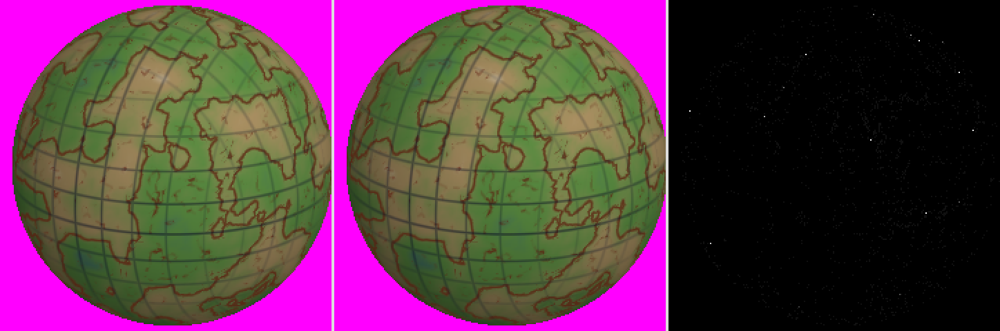
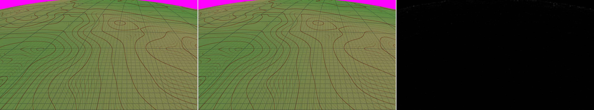
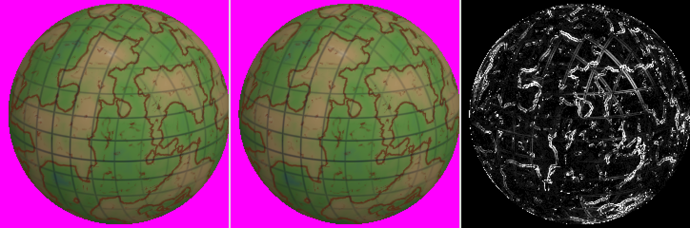
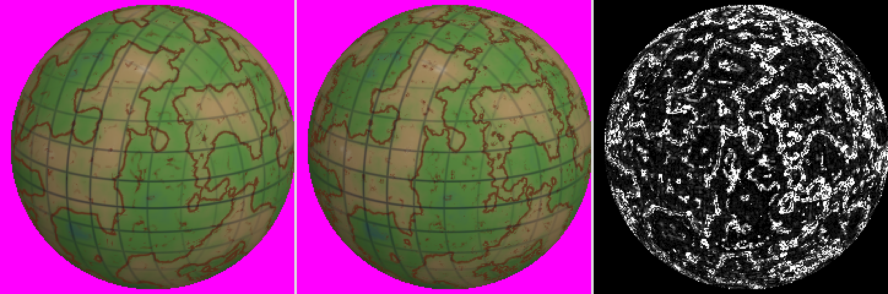
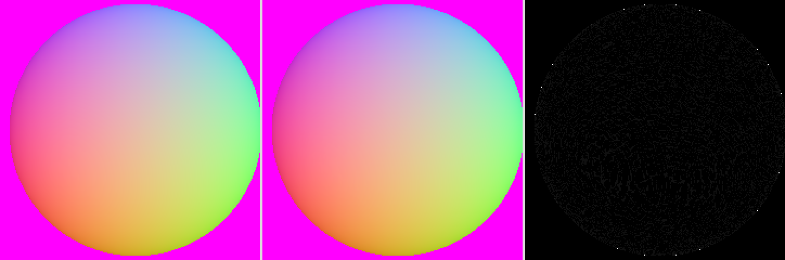
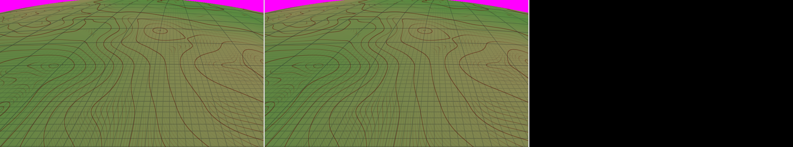
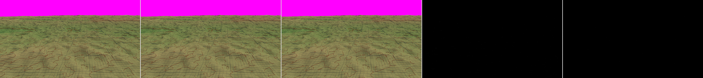
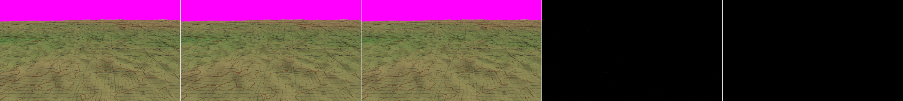
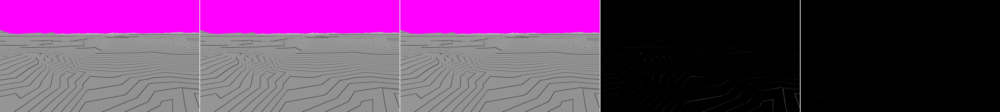

# SPIKE-12 Retiring the vertex tile format (sonnet-spikes, 2026-10-17)

Question from the owner via opus-planner: retire the vertex tile format from rendering, or keep both formats? Prototype code is on branch `spike/spike-12-vertex-retirement` (commit a7ecea2, cut from `explore/compact-storage-buffer`, never merged): process-global switches in `generators::compact` (`spike_set`), a level floor in `frame::lod` (`spike_set_floor`), a WGSL generator `render/src/compact_v2.rs` and the experiments in `crates/render/tests/spike12.rs` (`t1_` to `t9_`, run with `--ignored`). All numbers below come from those tests; the tables they wrote are next to this file. Reference field `Reference(1)` unless stated, cells 32, 2560 x 1440 and tau 6 for plans and timings, 960 x 540 for images. GPU timings are **indicative** (not a perf window), RTX 3080 Ti Laptop on Vulkan, taken 2026-10-17 at about 11:31 local time after sonnet-explorer confirmed the GPU free; the images ran on WARP and on the RTX.

## Short answer
1. **Retire it, and use a render floor at level 3 plus a wide texel for every tile.** Both prototypes work; the alternatives measured worse.
2. **Levels 0-2: floor at level 3, not a 5x5 base.** The 5x5 base is accurate (0.0018 px at orbit against 0.46 px for 3x3) but costs vertex-stage time on **every** tile: +9.8 % at aerial-200km and +47.6 % at ground-1m (2.74 ms against 1.86 ms, indicative), and +192 B per record. The floor costs nothing in nine of the ten standard views (they never draw levels 0-2: their plans are identical, 0 pixels differ) and +129 nodes (52 level-2 nodes become 181 level-3 nodes) at orbit: GPU time 0.174 ms to 0.321 ms there (indicative), no extra bytes per slot.
3. **Cliff tiles: one wide texel for all tiles, not a per-slot variant.** The 32-bit height with two 15-bit normal components keeps the 8 B texel, holds CON-13 (step 0.0004 mm at 1.9 km of relief, against 28.6 mm for 16 bits) and CON-14 (worst 0.0071 degrees against 0.01) on the steep field, and its GPU time equals the 16-bit texel (ratios 1.001 to 1.005 at ground-1m, aerial-200km and the steep field). A shader carrying both decoders with a per-slot flag costs 0.3-1.5 % more and adds a second code path, so it buys nothing.
4. **The price is bytes and a pool-arithmetic change, not time.** The climate block (324 B) leaves the spare texel channel and moves into the slot; the slot becomes 9,360 B (+5.9 %) and the record must stop being a "fixed item" of the 128 MiB reserve (with the reserve unchanged the mid share would fall from 230,640 to 123,008 slots). Charged per slot: 215,085 slots at the mid share (-6.7 %), 329,797 at the high share.
5. **Cost: about 8 coder days in four small OpenSpec changes, one perf window, all terrain goldens through `golden-review`.** Recommendation: retire, **early M6**, not before item 8's perf window (reasons in Q5).

## Q1. Levels 0-2

### Position error of the base surface (T1, T2)
Actual builder and CPU mirror (`compact_tile_field(...).shade_all()`) against `tile_mesh_field`, 24 random tiles per level, every grid and skirt vertex, position and morph target. Pixel size by SPIKE-06's convention (tile edge / 190 px):

| level | tile edge m | 3x3 max px | 5x5 max px |
|---|---|---|---|
| 0 | 1.0e7 | 3.63 | 0.351 |
| 1 | 5.0e6 | 1.39 | 0.039 |
| 2 | 2.5e6 | 0.527 | 0.0020 |
| 3 | 1.25e6 | 0.163 | 0.0002 |
| 4 | 6.3e5 | 0.038 | 0.00004 |

At the standard view that draws levels 0-2 (orbit-20000km at 2560 x 1440, 52 level-2 nodes) the real screen-space error, with each node's own distance, is **0.463 px worst (0.255 mean) for 3x3 and 0.0018 px worst for 5x5** (`t2-orbit-error-px.md`). Level 0 and 1 tiles are never drawn in the ten views; they matter only for a camera farther than 20,000 km, where a 5x5 base would leave 0.35 px at level 0. This reproduces the duality exploration's model within a factor 2 at levels 0-1 (0.18 px modelled, 0.35 measured, f32 and the shell geometry) and exactly at level 2.

### Option (a): 5x5 base surface
Prototype: 16 more control points in the record (+192 B, 320 B), quartic Lagrange basis, unrolled WGSL rows (`compact_v2.rs`). GPU time, RTX, relief view, 2560 x 1440, 300 interleaved frames (`t5`, `t8`):

| view | baseline ms | 5x5 base (all tiles) ms | ratio |
|---|---|---|---|
| orbit-20000km (52 nodes, levels 0-2 now compact) | 0.183 (3x3) | 0.205 | 1.12 |
| aerial-200km (630 nodes) | 2.096 | 2.301 | 1.098 |
| ground-1m (2,378 nodes) | 1.858 | 2.741 | **1.476** |
| steep field, ground-200m (4,160 nodes) | 1.158 | 1.571 | 1.356 |

The cost is the vertex stage (SPIKE-06's lesson holds): `place` evaluates the base surface and its normal up to five times per vertex, and 25 points cost about three times 9. A 5x5 base only for coarse slots (a flag in the record, a uniform branch) would leave fine tiles at today's cost, but needs both evaluators in one shader and either 320 B per record for every slot or a side table: more code than option (b) for the same result.

Image difference against the current vertex path (`t4-image-diff-*.md`, RTX; WARP within 1 %). Orbit-20000km, 960 x 540 (16 nodes at this size), relief view: 5x5 differs in **1,604 of 518,400 pixels (0.31 %; 11 by more than 8 levels, the silhouette and contour lines)**, 3x3 in 30,772 (5.9 %; 3,112 over 8 levels). On views without levels 0-2 the 3x3 compact path is byte-identical to the product (aerial-200km: 0 differing pixels in all nine debug views, which also shows the flat-record shader generator does not change a pixel), but the 5x5 base moves **every** view at rounding level: aerial-200km relief 4,358 pixels (0.84 %, 11 over 8), height 1,666, depth 669. So 5x5 on all tiles moves every terrain golden.

### Option (b): render floor at level 3
Prototype: `select_impl` splits every tile above the floor (`spike_set_floor(3)`), culling unchanged. Draws and slots at the ten standard views (`t3-floor-counts.md`):

| view | nodes without floor | nodes with floor 3 |
|---|---|---|
| orbit-20000km | 52 (all level 2) | **181 (all level 3)** |
| the nine others | 11,661 in total | 11,661, identical plans |
| total | 11,713 | 11,842 (+129, +1.1 %) |

Slots: 181 x 8,840 B = 1.6 MB resident at orbit; levels 0-2 (126 tiles, 6 % of the 2,046 tiles of the default pre-fill of levels 0-4) need no slot, no vertex pool and no pre-fill record. GPU time at orbit 0.174 ms to 0.321 ms (+0.147 ms, indicative; the timing run was taken before the floor leaves' morph was suppressed, which changes data, not instructions); aerial-200km unchanged (2.094 ms both). Images: the orbit plans differ in detail (at 960 x 540 the vertex path draws 16 tiles, the floor 181, so contour lines and shading move: 35,489 pixels, 6.8 %, relief view, 7,610 over 8 levels: this is more geometry, not an error; see the Visuals), every other view is byte-identical. What changes:
- **LOD selection** (`frame/lod.rs`, `select_impl`): `level < floor` forces a split (one line), and a leaf at the floor must be treated like a root: no drawn parent, no morph (selection morph 0, interval `[1e30, 1e30]`) and an exemption in the plan's "empty morph interval" check (`frame/terrain.rs`, one more line). Without it the prototype's first run morphed every floor vertex beyond 11,380 km to the undrawn level-2 grid, and the plan builder refused the root-like interval. The terrain-lod spec's morph requirements need the floor's wording (spec delta).
- **Residency and cold start**: the ancestors (levels 0-2) are no longer fallbacks, so a missing level-3 tile at orbit is a hole until it arrives (181 tiles, 1.6 MB: instant with the pre-fill, a visible wait without it). `managed.rs` tests that assume level-0 roots (1,482 lines of tests, the cover and bounds code) need the floor as a parameter.
- **Pre-fill** (ADR 0045, default levels 0..=4): becomes 3..=4, 2,040 tiles instead of 2,046; the pack drops its vertex-form records.
- **Goldens**: only the orbit goldens (tile ids, levels) change by declaration.
- **Camera beyond the standard orbit**: with a floor, a view from 100,000 km draws up to 384 level-3 tiles where it drew a handful; still 3.4 MB and below the aerial views' load.

Why (b) over (a): zero bytes per slot, zero cost anywhere but orbit, one shader path, no golden moves outside the orbit views, and the spec change is one number. (a) remains the only option that draws a level 0-2 tile accurately, but no standard view, the pre-fill or the product needs one drawn.

## Q2. The cliff texel

Prototype (`SPIKE_WIDE`): the texel stays 8 B and two `u32` words in the buffer block: word 0 is the 32-bit height step count (`hr_min + f32(q) * hr_step`, step = relief / 4,294,967,295), word 1 holds two 15-bit signed octahedral components (scale 16,383) in bits 0-14 and 15-29, two bits spare. The climate leaves the texels' fourth channel and is read from the record (81 words, Q3). `compact_tile_field`, the CPU mirror, the record, the WGSL decode (`extractBits`) and the fragment-stage climate read are generated from the same switch.

### CON-13 and CON-14 on the steep field (T6, CPU mirror against `tile_mesh_field`, 6 random tiles per level)

| field | level | texel | relief m | height step mm | height error mm | normal error deg | CON-13 | CON-14 |
|---|---|---|---|---|---|---|---|---|
| steep | 9 | 16-bit | 1,875 | 28.6 | 14.4 | 0.0034 | FAIL | ok |
| steep | 9 | **wide** | 1,875 | **0.0004** | 0.244 | **0.0068** | ok | ok |
| steep | 12 | 16-bit | 805 | 12.3 | 6.3 | 0.0036 | FAIL | ok |
| steep | 12 | **wide** | 805 | 0.0002 | 0.488 | 0.0071 | ok | ok |
| steep | 16 | 16-bit | 142 | 2.2 | 1.2 | 0.0035 | FAIL | ok |
| steep | 16 | **wide** | 142 | 0.00003 | 0.244 | 0.0068 | ok | ok |
| steep | 22 | 16-bit | 6.7 | 0.10 | 0.24 | 0.0035 | ok | ok |
| steep | 22 | **wide** | 6.7 | 0.000002 | 0.244 | 0.0070 | ok | ok |
| reference | 9 | 16-bit | 72 | 1.10 | 0.61 | 0.0034 | FAIL | ok |
| reference | 9 | **wide** | 72 | 0.00002 | 0.122 | 0.0065 | ok | ok |

(Full table `t6-wide-texel-con13-con14.md`; the wide step column is relief / 2^32, the table file prints it rounded to 0.0000.) The wide texel holds 1 mm everywhere: the height error 0.12 to 0.49 mm is the f32 granularity of the compared heights themselves (5 km at 0.49 mm), the same in both formats. CON-14: the 15-bit normal's worst angle over all rows is 0.0072 degrees (the earlier study predicted 0.0074), 28 % under the 0.01 bound; the 16-bit normal stays at 0.0036. Two limits stay: the reconstruction `hr_min + f32(q) * hr_step` is exact only to relief x 3e-8 (`f32(q)` rounds above 2^24), so 1 mm holds up to about 30 km of relief in one tile (the steep field has 1.9 km at level 9, a finest tile 7 m or less; the Earth-sized reference field has millimetres at level 22); and the stored normal is the f64 stencil normal, so 15 bits quantise it, not the mesh.

### Images (T7, steep field, `Steep(1)`, cells 16, finest level 12, 960 x 540; the CPU mesh as vertex buffers against compact 16-bit tiles with the relief guard off and against wide tiles)
At low-2km (1,016 nodes), relief view: 16-bit differs in 2,842 pixels (max 20 levels, 5 over 8), **wide in 1,193 pixels, at most 1 level**; height view 1,179 pixels (max 21) against 40 (max 1); ground-200m height view 5,194 (max 2) against 234 (max 1), normals view 16-bit max 52 (5 over 8) against wide max 1. The aerial-200km rows (29 and 43 levels at a handful of pixels) are the same pixels for both texels, so they do not come from the texel (edge pixels; not investigated further). The wide rows are single-level rounding: the 15-bit normal against the mesh's f32 normal. WARP agrees within 3 %.

### On the normal Reference field the wide texel moves images at rounding level (T10)
Ten standard views, relief, normals and height debug views, 960 x 540 (RTX): 0 pixels differ at orbit and ground-1m normals; elsewhere 2 to 8,302 pixels per frame (at most 1.6 %), **almost all by one level**; the largest difference anywhere is 12 levels (one relief pixel at high-2000km) and 1 pixel over 8 levels in all 30 frames. Rounding noise in the sense of ADR 0017.

### One layout or a per-slot variant
**One layout for all tiles.** Evidence (GPU time of the render pass, RTX, 2560 x 1440, relief, 300 interleaved frames, indicative; baseline = the product's 16-bit texel on buffer blocks, `t8`):

| view | flat-record generator only | wide texel | both decoders (per-slot flag) |
|---|---|---|---|
| ground-1m | 1.011 | **1.005** | 1.015 |
| aerial-200km | 1.001 | **1.001** | 1.003 |
| steep field ground-200m (timing only) | 1.005 | **1.001** | 1.009 |

The wide texel costs nothing in the vertex stage (one 32-bit read, one `extractBits` pair, an integer to float conversion), the same 8 B per texel, so no byte cost in the texel block. A per-slot variant would need the flag in the record, both decoders in the shader (+0.3 to 1.5 %), the climate in two places, and keeps the `vertex_reason` relief branch alive as a flag decision: it saves nothing and keeps one of the special cases the retirement removes. Bytes per slot: texels 8,712 unchanged; the climate block moves out of the spare channel into the slot (+324 B); the whole slot grows 8,840 B to 9,168 B (+3.7 %) for the wide texel alone, 9,360 B (+5.9 %) with the 5x5 header (not recommended) — see Q3.

## Q3. The slot: climate, a per-tile block and the record without a second resource

Today a compact tile is two resources: 8,712 B of texels in a block (texture or, after ADR 0054, a buffer) and a 128 B record in the record buffer, with the 324 B climate field squeezed into the spare 16 bits of 162 texels. With storage-buffer blocks a slot can hold everything in one stride. The prototype validated the *reading* side (climate and the extra control points read from the record region of a flat `array<u32>`, T4/T7 images identical to the product within rounding); it kept the records in their own buffer, as today, because moving them into the block only changes the offset arithmetic. Concrete layout (byte offsets in a slot, cells 32, 16-byte aligned stride):

| offset | bytes | content |
|---|---|---|
| 0 | 128 | header: 9 control points (108), `hr_min`, `hr_step`, `h_origin`, skirt depth (16), flags (4: bit 0 flip, bit 1 wide texel) |
| 128 | 192 | the 16 extra control points of the 5x5 base surface (only if the 5x5 base is adopted) |
| 320 | 324 | climate block: 81 words, temperature f16 in the low half, precipitation f16 in the high half |
| 644 | 4 | pad to 8 |
| 648 | 8,712 | 1,089 texels of 8 B: 32-bit height step count, then 15 + 15 bit octahedral normal in the second word (2 spare bits) |
| 9,360 | | stride (a multiple of 16; 9,360 = 585 x 16) |

A future per-tile block (item 7's water mask, for example) is appended after the climate block and moves the texel offset by its size; the offsets are constants of the layout version, so nothing else changes. Without the 5x5 base the stride is 9,168 B (header 128 + climate 324 + pad 4 + texels 8,712), with the 5x5 base and 16-bit texels it is 9,032 B.

Against ADR 0033's shares (`fit_share_with`, FIXED_RESERVE = 128 MiB, 128 MiB blocks; T9):

| layout | slot bytes | mid share (2 GiB) | high share (3 GiB) |
|---|---|---|---|
| today (texels + 128 B record in the reserve) | 8,840 | 230,640 slots (15 blocks) | 353,648 (23 blocks) |
| v2 as prototyped, records still in the reserve (the pool arithmetic unchanged) | 9,356 | **123,008 (8 blocks)** | **123,008 (8 blocks)** |
| v2 with the record inside the slot (stride 9,360), reserve unchanged | 9,360 | 215,085 (15 blocks of 14,339) | 329,797 (23 blocks) |

The middle row is the trap: the reserve of 128 MiB (ADR 0033) holds the records of every slot, so a 644 B record cuts the mid share to 8 blocks and the tier counts above 123,008 slots would fail the reserve check. The record has to become part of the slot's cost (the last row: -6.7 % slots at both tiers, the 5.9 % byte increase plus the lost granule). The reserve then holds only the node records, the globals and the index buffer (and the vertex pool goes away with retirement: its 512 slots x 53.7 KB = 27.5 MB return to the share). This is a change of the pool arithmetic of `frame::pool` and `streaming::budget` and of the share table of ADR 0033 point 3, not a surprise at the end.

## Q4. What remains, what goes, what changes

**What is left of the vertex format:** the CPU reference and oracle only: `tile_mesh_field`, `TileMesh`, `MeshVertex` (positions, normals, morph targets and the mesh key; the steep-field and seam tests, `oracle_compact_mirror`, the CPU mirror's comparison). About 375 of `generators/src/mesh.rs`'s 416 lines stay; `GPU_STRIDE`, `gpu_climate` and `to_floats` (about 40) go. `vertex_tile_field` survives in test support only.

**Production lines that go** (counted by reading the functions that exist only for the vertex path; +-15 %; the duality exploration's 750 was a floor):

| file | lines | what |
|---|---|---|
| `render/src/terrain.rs` (2,634) | about 450 | the vertex shader stage and `tile_climate` of the vertex shader (31); the attribute tables and vertex pipelines in `build`, `enable_lit`, `enable_atmosphere` (about 150); the vertex draw loops and pipeline switching in `render_inner` (about 100); the vertex and fallback branches of `place_tile` (50); `write_vertex_tile`, `vertex_bytes_into`, `vertex_slot_buffer`, `vertex_pool_buffer`, `block_buffer`, `release_fallback`, the format counters (about 90); `Place::{Vertex, Fallback}`, `ResidentFormat`, `TileRef`, `DrawBuffer::{VertexPool, Block}` uses (about 30) |
| `render/src/{water,lit,atmosphere}.rs` | about 60 | vertex-flavour pipelines and entry points |
| `frame/src/{pool,draw}.rs` | about 75 | `vertex_format_pool`, vertex slot maths, the vertex draw-run kinds |
| `streaming/src/{slots,budget}.rs` | about 80 | `PoolKind::Vertex`, the 512-slot vertex pool and the 256-slot fallback region (27.5 MB reserve returned) |
| `cache/src/meshpack.rs` (552) | about 130 | the vertex payload codec and `RenderForm::Vertex` (and its key parameter) |
| `generators/src/compact.rs` (514) | about 75 | `VertexReason`, `vertex_reason`, `FALLBACK_RELIEF_M`, `RenderTile::Vertex` (the enum collapses to `CompactTile`), the relief guard in `tile_data_field` |
| `generators/src/mesh.rs` | about 40 | the GPU-side layout |
| `app` | about 60 | `--tile-format`, the software-smoke special case |
| total | **about 950** | against about 200 added (wide texel and record v2 about 150, the floor 20, climate moved into the slot about 30): net about -750 |

**Tests** (none weakened: each test of a removed path is replaced by one of the new path):
- The 5 vertex-only renderer tests (`gpu_pools`, `gpu_warmup`, `streaming/slots`) are replaced by their compact equivalents (pool slots, warm-up, slot reuse).
- The 15 parametrized `for compact in [false, true]` tests lose a branch and keep their compact side.
- The 15 level 0-2 / fallback tests (CON-13's "falls back to the vertex format") become: (a) "a finest tile with 1.9 km of relief is compact and holds 1 mm / 0.01 degrees" (the T6 rows as a tier-B test), (b) the floor tests (leaves never above level 3; floor leaves do not morph; the plan accepts them).
- **The differential references.** Several tier-C tests ("the product's compact image equals the vertex image up to edge pixels", the morph and seam differentials) use the vertex GPU path as an independent reference. Deleting the path deletes those references. The CPU mirror (`oracle_compact_mirror`) already covers positions, heights and normals at tier B, but a shader bug in the compact stage is only caught by an independent *image*. I recommend keeping a test-only vertex renderer under `crates/render/tests/support` (about 150 lines: one pipeline, one buffer, no pools or fallback) as that reference; it is not product code and keeps these tests meaningful. Without it the retirement weakens the shader tests, which the rules forbid.
- About 40 of the 805 integration tests are touched (the four heuristic categories overlap), about 1,200 test lines changed or removed.

**Goldens.** The wide texel moves pixels at rounding level (T10: one level, 0 to 1.6 % of a frame, one pixel over 8 levels in 30 frames); `Tolerance::Exact` needs all 18 terrain-view goldens and the lit, atmosphere and water ones regenerated, which the `golden-review` skill classifies as rounding noise (ADR 0017) and auto-blesses on both adapters with the cross-check. The two orbit goldens change by declaration (the floor: tile ids, levels, geometry). With the 5x5 base in all tiles the noise would be larger (T4: 0.3 to 6 % of pixels at aerial-200km and high-2000km relief) and the GPU time +10 to +48 %: another reason against it.

**MESH_VERSION and caches.** `MESH_VERSION` 7 to 8 (the compact tile's content changes: texel layout, climate in the record, record layout). The meshpack payload gets version 3 (compact form only; the vertex form is removed), the pre-fill (levels 3..=4) is rebuilt and old packs are misses, as in version 2 (ADR 0039). The mesh key's finest-class component (`finest_class_key`) goes with the relief guard: the format no longer depends on the view's finest level.

**Specs and ADRs that need a delta** (the architect decides, not this spike): ADR 0033 points 3 (slots and pools: the 512-slot vertex pool, the record in the reserve), 4 (the compact format: texel, climate placement), 5 (CON-13's fallback becomes the wide texel) and 6 is untouched; ADR 0045's pre-fill levels; terrain-lod (floor, root-like leaves) and renderer (REND-016 texel and record) specs; ADR 0054 (the slot stride) if it merges first.

## Q5. Plan, cost, risks, recommendation

Order (each step one OpenSpec change of one subsystem; every step ends green and keeps the vertex path until step 3):
1. **`compact-slot-v2`** (generators, cache, render): wide texel, climate block and record inside the slot, `MESH_VERSION` 8, payload version 3, CPU builder and mirror, WGSL decode, the CON-13/14 tier-B tests, the vertex fallback keeps serving cliff tiles until step 4. Builds on ADR 0054's buffer blocks (item 7c, sonnet-explorer). **2.5 days.**
2. **`pool-arithmetic-per-slot`** (frame, streaming): the record charged per slot, the reserve table of ADR 0033 point 3, the share tests. Can be merged into step 1 if the same session does both. **1 day.**
3. **`render-floor-3`** (frame, streaming, app): the floor and its root-like leaves in selection, the plan check, the pre-fill levels, `managed.rs` roots, the orbit and cold-start tests. **1.5 days.**
4. **`remove-vertex-render-path`** (render, frame, streaming, cache, app): the deletions of Q4, the flag, the test-only reference renderer, the test replacements. **2 days.**
5. **Goldens and one perf window**: `golden-review` over all terrain goldens, one window to re-measure the vertex stage at P0 (the numbers above are indicative only). **1 day**, of which the window is under an hour.

**Total about 8 coder days** (2.5 + 1 + 1.5 + 2 + 1; range 7 to 9), against the duality exploration's 5-7: the extra day or two are the pool arithmetic and the test-only reference renderer, which the first estimate did not see. Items 1+2 and 3 are independent and can run in parallel sessions.

Risks: (1) the reserve arithmetic (Q3's trap: 123,008 slots if forgotten); (2) the lost independent vertex-path reference (mitigated by the test-only renderer); (3) cold start at orbit has no coarse fallback (181 tiles, 1.6 MB; the pre-fill covers it); (4) a camera farther than the standard orbit draws up to 384 tiles instead of a few; (5) the GPU numbers here are indicative (the unmeasured parts: the lit path with the atmosphere, WARP's device removal with compact tiles plus atmosphere which stays test-only); (6) the wide texel's f32 reconstruction limits 1 mm to about 30 km of relief in one tile (not reachable by any generator today).

**Recommendation: retire, in early M6, not in M5.** For: the duality is a recurring cost that grows with every per-tile attribute (item 7's water mask, ADR 0051 point 6, would otherwise be built twice); both blockers are now measured and cheap (floor: +0.15 ms at orbit only; wide texel: +0.1-0.5 % GPU time); the slot gets one layout with room for per-tile blocks; about 750 lines net removed. Against doing it in M5: it moves every terrain golden and needs a perf window, the gate is close, and nothing in M5's remaining items depends on it. If item 7's water mask lands first, build it against the slot of step 1 (the climate block shows the shape) and the vertex path gets no mask at all, which is correct for levels 0-2 only if the floor lands too. **Do not adopt the 5x5 base**: it is the expensive option (+10 % to +48 % vertex-stage time on every tile) for a case the floor removes.

Owner decisions: (a) retire or keep (this spike recommends retire, early M6); (b) the floor at level 3 (a visible change at orbit: 181 level-3 tiles instead of 52 level-2 tiles, more detail, one more draw group); (c) the slot grows 5.9 % (9,360 B against 8,840 B) and the tier slot counts fall 6.7 % (215,085 mid, 329,797 high) unless the reserve is re-cut: ADR 0033's numbers change.

## Limits
- Timings are indicative (one machine, GPU clock state not controlled, 300 frames, the relief debug view, not the lit path with the atmosphere; steep-field timing rows quantise cliff tiles in 16 bits and are timing only). The floor's orbit timing was taken before the floor leaves' morph was suppressed (same instructions, other data).
- The images are 960 x 540 debug views of the `Reference` and `Steep` fields; the orbit comparison at 960 x 540 has 16 vertex-path nodes against 52 at 2560 x 1440.
- Line counts are from reading, +-15 %. Day counts are estimates, not measured.
- The record in the prototype stayed in its own buffer; the interleaved slot stride of Q3 is arithmetic plus the validated read side, not built.
- 5x5 for coarse slots only (a flag in a record of fixed stride) was not built; its cost is argued from the all-tiles numbers.
- One world seed, cells 32 (16 for the steep field).

## Files
`t1-base-error-by-level.md`, `t2-orbit-error-px.md`, `t3-floor-counts.md`, `t4-image-diff-{rtx,warp}.md`, `t5-gpu-time-orbit-aerial-rtx.md`, `t6-wide-texel-con13-con14.md`, `t7-steep-images-{rtx,warp}.md`, `t8-gpu-time-layouts-rtx.md`, `t9-share-arithmetic.md`, `t10-wide-texel-image-noise-{rtx,warp}.md`.

## Visuals
Each sheet is vertex path | candidate | difference (gain 16; steep sheets: vertex | 16-bit | wide | diff 16-bit | diff wide, half size). 960 x 540 frames; orbit sheets are cropped to the planet and doubled.

**Levels 0-2, option (a): 5x5 base surface**

**Why the 3x3 base is not enough at levels 0-2**

**Levels 0-2, option (b): render floor at level 3** (a different plan: 181 level-3 tiles against the vertex path's own tiles, so the difference is added detail)

**The cliff texel against the CPU mesh on the steep field**

