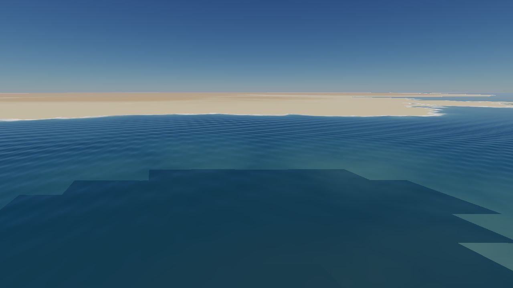
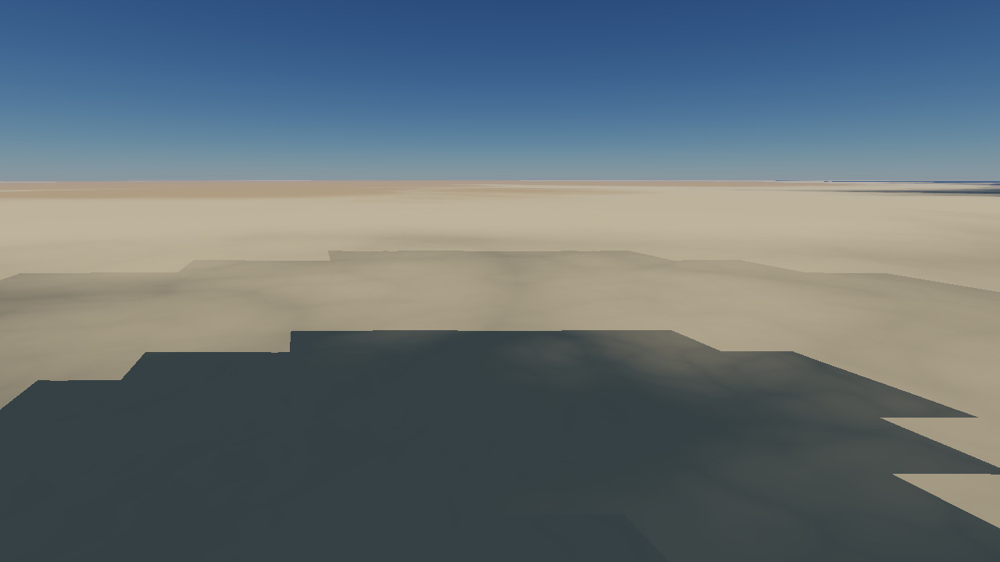
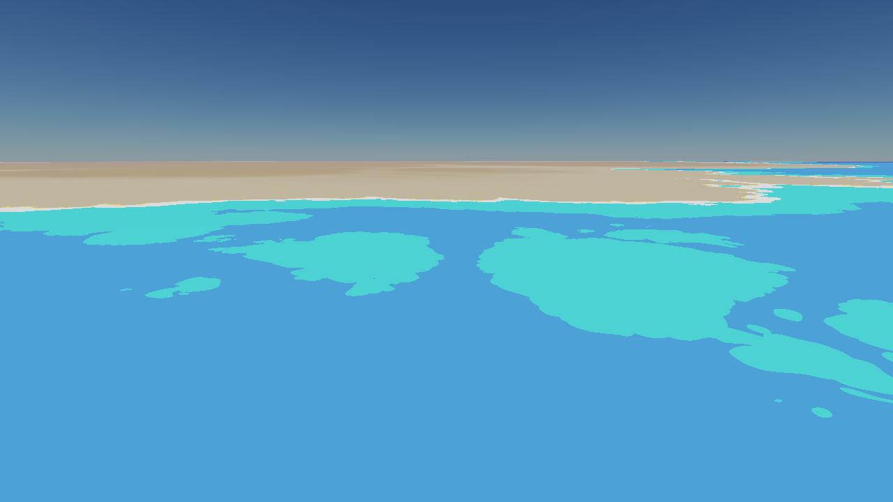
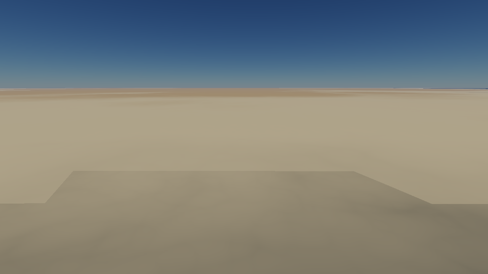
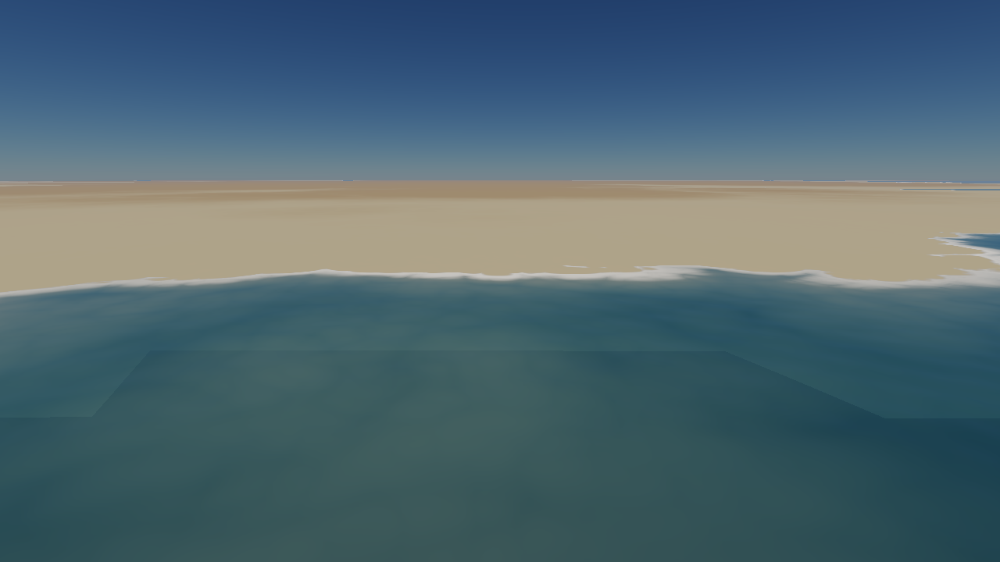
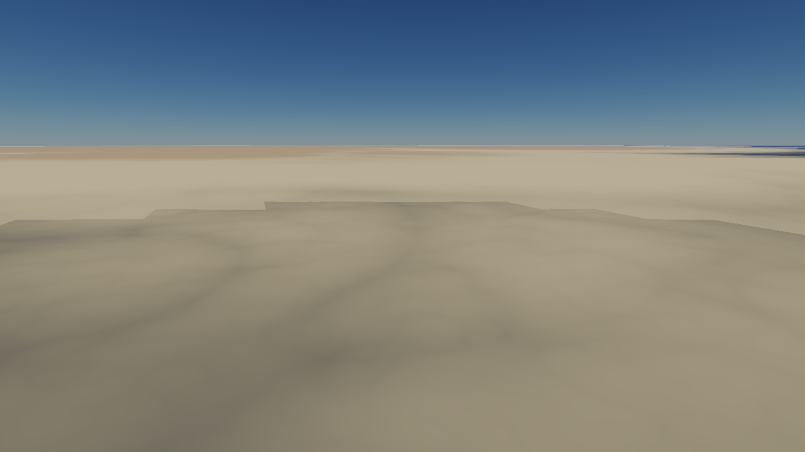
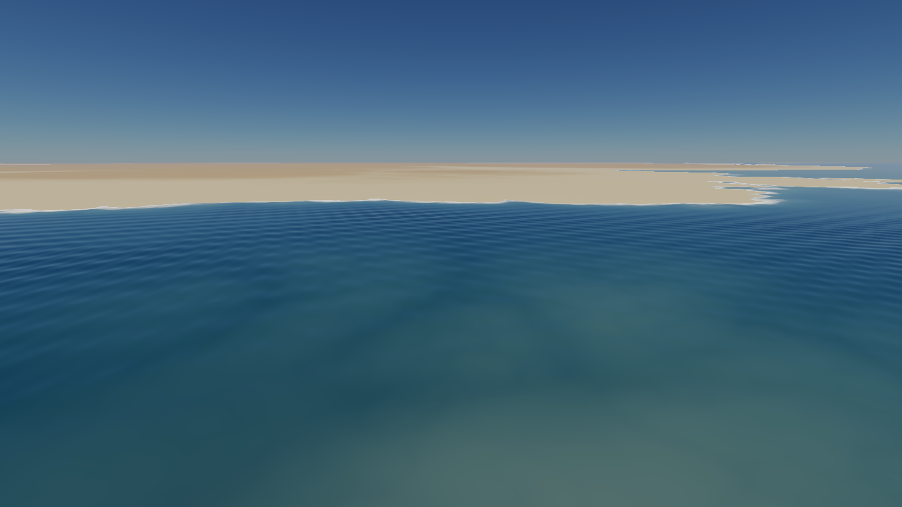

# SPIKE-16 results: dark patches over the sea while the camera moves (water-motion-gap)

Diagnosis only (owner, 2026-10-19). Spike code: branch `spike/water-motion-gap` (never merged). Machine: Rasierklinge, RTX 3080 Ti Laptop, Vulkan, release build, 1280x720.

## Answer in one paragraph
**The water is not missing.** The dark patches with straight, tile-shaped edges are the **terrain's albedo**: the shore ramp that blends the seabed colour into the beach colour is `shore_ramp_min_m(level)` of the *drawn node* (REND-030), so one and the same seabed point (2.5 m under the sea) is light under a coarse tile (ramp 4.8 to 8 m) and dark under a fine tile (ramp 1.2 m or less), by a factor of 4.9 in luminance. A still camera draws the exact plan, whose near tiles are L16 to L19; a moving or rotating camera draws the **cover** (the resident set, descended wherever a tile is resident), whose near tiles are L19 to L20, finer than the plan needs. Fine tiles darken their seabed, the coarser neighbours stay light, and the albedo steps along tile borders. The water pass draws over it with the absorption of the dark ground below, so the sea looks dark and flat in those patches and the seabed seems to "show through".

## Method
1. A scripted path in the viewer's own pipelined loop (`test-render --perf-smoke --scene look-2km --lit --allow-memory-bake --global-res 256 --adapter hardware`, the streaming `Driver`, which draws the water of the frame exactly as `window.rs` does): the coast of the lit scenes (`lit_coast`), the camera 80 m over the sea level 400 m off the shore, pitched 12 degrees: 120 still frames, a 10 s yaw sweep of +-90 degrees, 20 s along the shore at 200 m/s (the free camera's speed at 80 m is about 200 m/s, spike 11), then 10 s of sweep gliding back; 2,532 frames at 60 fps. A first run with an 8 m/s glide did not show the effect (the tiles kept up); the viewer's real speed does.
2. A diagnostic record in `plan_water` for every node of the drawn plan: kept, or cut and why (no water answer, horizon, loose height, exact minimum), with the tile's true lowest height (9x9 samples of the field). A **gap** is a node within 20 km whose terrain lies under the sea level and that has no water node.
3. At every 40th frame: the lit image, the same plan with the water pass off (terrain only) and with the water class view.
4. A/B: the same run with the albedo's ramp computed as if every node's level were at most 18.

## Evidence
- **Hypothesis (a) is refuted.** The water plan is made from the drawn plan itself (`window.rs:279-297`; the driver does the same), with the camera of that plan: `plan.camera.position == request camera` in 2,532 of 2,532 frames (runs 4, 6, 7), and a water node refers to the drawn plan's own node index.
- **Hypothesis (b) is refuted.** Gaps: 0 in 2,532 frames of each of three runs. Near nodes at frame 1201: 40 of 40 are `kept`, L19 and L20, their true seabed minimum -2.2 to -3.2 m (below the level), the exact minimum of their own mesh the same (`run6-frames.log`, the "near" lines after frame 1201). The class view of the frame shows water on every sea pixel (`images/moving-water-class.png`).
- **Terrain only, same frame** (`images/moving-terrain-only.png`): the dark patches are in the terrain. `images/still-terrain-only.png` (frame 81, still): the near tiles are L18/L19 and the same seabed is light.
- **Levels by phase** (nodes within 400 m of the camera, `run6-frames.log`): still (frames 41 to 121, Stale plans): L16 to L19. Rotation and glide (Cover plans, frames 161 on): L19 and L20 (36 to 40 of the 40 nearest nodes at L20 from frame 601). 2,400 of 2,532 frames were Cover plans: after the first second a camera that turns or moves at this speed never gets a usable stale plan.
- **Ramp by level** (cells 32, radius 6,371 km; `max(shore_blend 1.0, min(2 s(level-1), 8))` m) and the albedo luminance of a seabed point at height h under the sea, look defaults (seabed 0.06/0.08/0.09, beach 0.52/0.46/0.34):

  | level | ramp m | h = -1 m | h = -2.5 m | h = -4 m |
  |---|---|---|---|---|
  | 16, 17 | 8.0 | 0.447 | 0.374 | 0.270 |
  | 18 | 4.77 | 0.420 | 0.256 | 0.104 |
  | 19 | 2.39 | 0.317 | 0.076 | 0.076 |
  | 20 | 1.19 | 0.104 | 0.076 | 0.076 |
  | 21, 22 | 1.00 | 0.076 | 0.076 | 0.076 |

  The seabed colour (0.076) is reached at 2.5 m depth from L19 on; L17 gives 0.374, 4.9 times brighter.
- **A/B** (ramp clamped to level 18): the dark patch of frame 1201 is gone (`images/moving-terrain-only-ramp-clamped-18.png`, `images/moving-lit-ramp-clamped-18.png`); only a faint step at a still coarser border remains, where the clamp leaves the level dependence in place.
- The F9 bundle (change `water-motion-gap`) was not needed: no bundle file exists on that branch or in any worktree (only the capture tool), and the scripted path reproduces the frame.

## Why the ramp depends on the level, and is that needed
REND-030 (`LodParams::shore_ramp_min_m`): the albedo differs by a factor of eight between seabed and beach, so a ramp narrower than the height error between a node's mesh, its parent's and the morph between them makes the **shoreline** flash with decimetre height changes between frames (k = 1 left 4.3 % of the shore pixels flashing, k = 2 none). The error is the screen-space tolerance at the distance of the fragment, which is why the ramp is tied to the level: a level is drawn over a distance range. Two things follow:

1. **Some ramp is needed**, and it should scale with the screen-space tolerance at the fragment: `K x tau_px x pixel_angle x distance`, capped at `SHORE_RAMP_MAX_M`. That is a function of **world-space quantities of the fragment** (its distance from the camera), not of the node that happens to draw it.
2. **The level dependence is not needed**, and it is wrong whenever a node is drawn at a level the exact plan would not use there. `shore_ramp_at(z, morph)` blends a node's ramp to its parent's only across a morph interval, which makes the ramp continuous across **one-level** borders (the exact plan's neighbour rule). The cover (resident set), stale-plan substitutes and prefetched tiles put fine tiles next to coarse ones, and fine tiles where the exact plan would put coarse ones; the ramp, and so the albedo of the whole shallow seabed within `ramp` metres of the surface, then steps at every such border. A drawn level is not a quantity of the scene.

## Proposed root fix (not made)
Compute the ramp per fragment from the camera distance of the fragment: `ramp(d) = min(max(shore_blend, K x tau_px x pixel_angle x d), SHORE_RAMP_MAX_M)`, with `tau_px` and `pixel_angle` (fov / viewport height) in the plan, and drop `shore_ramp_min_m` from the node (and the ramp morph). Any tile drawn at distance d, fine or coarse, then gives the same albedo at the same point. Fine tiles drawn nearer than the plan needs have a smaller error than the tolerance, so the ramp stays safe for them; a coarser stand-in (a non-resident child) has a larger error, as it has today. The fragment's distance is in the shader already (the camera-relative position). Costs: a spec delta on REND-030 and on the albedo's f64 reference (`AlbedoParams::albedo_with_ramp` takes the ramp from the same function); `numerics-reviewer` (shader); the lit and water goldens move where the seabed is within the ramp (`golden-review`; owner-escalated classes); the coastal flicker metric (TEST-027, flicker budget 0.1 %) re-measured on the two coastal flights. An alternative that keeps the per-node field is the ramp of the level the *exact plan* selects at the node (needs the plan's level for each cover node; more plumbing, same outcome). A clamp (as in the A/B) is a diagnosis, not a fix.

## Test that would catch it
- **Tier A (GPU-free, cheapest)**: for one seabed point (height h = -2.5 m, a fixed distance d) the albedo from `AlbedoParams::albedo_with_ramp`, with the ramp a node of level L gets, for adjacent levels L and L+1 (and L+2), must agree within a tolerance (luminance ratio under 1.1): the same seabed point gives the same albedo under adjacent levels. Today it fails at L17, L18 and L19 (0.374, 0.256, 0.076). Mutation check: restore the per-level ramp.
- **Tier A on plans**: for the camera of this spike (coast, 80 m), the ramp that every node of a Cover plan and of the exact plan gets at the same ground point agrees (`draw_plan` with a resident set deeper than the plan, against the exact plan).
- **Tier C (WARP or RTX)**: render the cover plan and the exact plan of that camera, terrain only, and compare the seabed pixels (no tile-shaped luminance step; `images/moving-terrain-only.png` is the failing picture).

## Not found / open
- Whether the cover should descend beyond the plan's tolerance at all (finer-than-needed tiles cost upload and draw time, and they are what exposes the albedo step) is a streaming question, not part of this fix.
- The owner's own viewer was not run; the scripted path uses the viewer's loop and a 256-cell in-memory bake like the owner's run ("prefill n/a").

## Files
`results.md`, `run6-frames.log` (one line per frame: kind, node and water counts, cut reasons, gaps; the 40 nearest nodes every 40th frame), `images/`.

## Visuals

Frame 1201, RTX, lit with water: the dark patch with tile edges.

Same plan with the water pass off: the dark patches are the terrain's albedo (fine tiles, L19 and L20).

Water class view: water covers every sea pixel; nothing is missing.

Frame 81 (camera still, near tiles L18 and L19): the same seabed is light; a faint step at one tile border.

Frame 81, lit with water.

Frame 1201 with the ramp computed as if every node were at most L18: the dark patch is gone (A/B).

Frame 1201 lit with the clamp.
